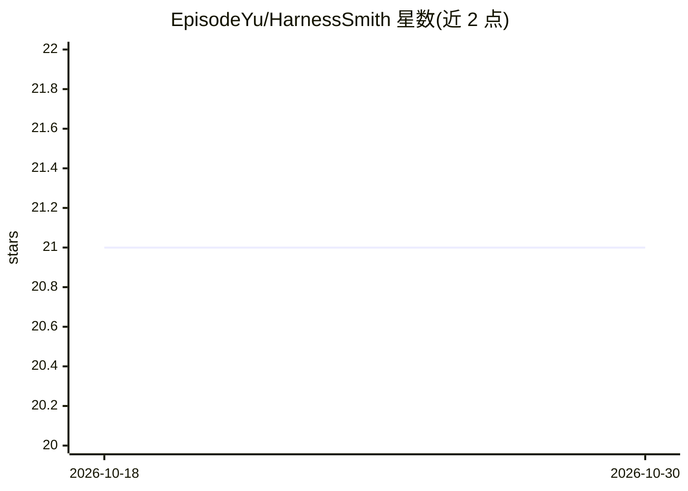

# EpisodeYu/HarnessSmith

⭐ 21 · Jinja · MIT · 推送 2026-07-21 · [GitHub](https://github.com/EpisodeYu/HarnessSmith) · 个人维护 · 中文 README

**配置转代码的 agent harness 生成器：产出自有的无框架 Python 智能体骨架**

类似 create-next-app 的脚手架生成器：通过 Web 向导、终端向导、预设或手写 YAML 描述 HarnessSpec，渲染出完整独立、可编辑、可测试的 Python 仓库。生成物为纯 Python 函数调用循环（核心约 150-300 行），不依赖任何 agent 编排框架，且生成后与生成器零关系。可选能力按需生成：MCP 客户端、Web 界面、多范式运行时、会话恢复、成本台账、上下文压缩、多智能体 subagents、跨会话记忆等。生成前经 uv sync、导入检查、模拟函数调用回合与 pytest 冒烟验证。面向想完全掌控 harness 代码的开发者，提供 PyPI 包与一键启动脚本。

## 筛选速览

| 维度 | 判定 | 备注 |
|---|---|---|
| AI 角色 | `ai-ecosystem` | LLM/agent 周边工具 |
| 许可风险 | `permissive` | MIT |
| 部署形态 | `self-host` | docker 或自建部署 |
| 模型依赖 | local-ok | 支持本地模型 |
| 硬件要求 | — | 无带数字的原话,不猜 |
| 安装摩擦 | `low` | 无编译、无系统依赖或容器化 |
| 成熟度 | — | 结构信号不足 |

## 能力要点

- 按 HarnessSpec 生成无框架依赖的独立 Python 仓库，生成后与生成器零关系
- 双 LLM 协议运行时可切换：OpenAI 兼容客户端（经 base_url 接 vLLM/Groq 等）+ 原生 Anthropic Messages 客户端
- 可选 MCP 客户端（stdio/HTTP/SSE）、多智能体 subagents、跨会话记忆、Agent Skills（SKILL.md 标准）
- 生成时锁定依赖并冒烟测试（uv sync、导入检查、mock 函数调用回合、pytest）

## 适用场景

- 不想被 LangGraph/ADK 等框架锁定，生成一个自己完全拥有的 agent harness
- 按需勾选 MCP、Web UI、记忆、subagents 等能力定制骨架
- 快速获得带测试、lockfile、Dockerfile 的可运行 agent 项目起点

## 场景标签

`代码生成` · 领域:编码与开发

## 证据(README 行号)

> L7: A config-to-code generator that produces a standalone, framework-free agent harness you fully own — no LangChain, no
> L62: HarnessSmith is a generator for the agent harness, in the spirit of `create-next-app`. A specification (`HarnessSpe
> L66: - **No agent-framework lock-in.** The generated code has zero dependency on any agent-orchestration framework. The 

## 星数曲线

2026-10-18 21 → 2026-10-30 21（+0）

---
*卡片 v1 · prompt 1.4 · 生成 2026-10-28 · 置信度 mid · 依据 README sha `5f7cfbd765b3` · [字段定义](../../DATASET.md)*
