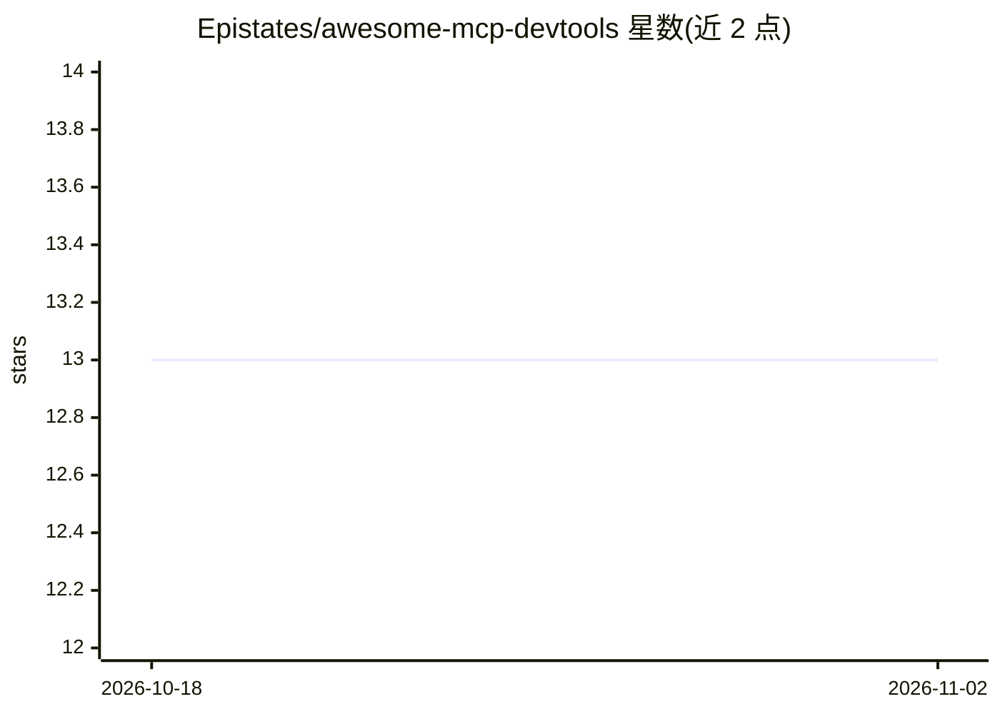

# Epistates/awesome-mcp-devtools

⭐ 13 · MIT · 推送 2026-09-14 · [GitHub](https://github.com/Epistates/awesome-mcp-devtools) · 个人维护

**MCP 开发者工具策展清单：SDK、框架、测试与网关等 100+ 条目**

围绕 Model Context Protocol（MCP）的开发者工具聚合清单，按 SDK（覆盖 JavaScript/TypeScript、Python、Java、Go、Rust、Kotlin、C#/.NET、Scala、Dart、Ruby、Elixir、C/C++、Swift、Bash、Common Lisp 共 15 类语言）、框架、测试工具（含授权测试与安全扫描）、代码库和实用工具（代理与网关）组织条目，部分标注官方资源与代码语言徽标，SDK 按 GitHub stars 排序。面向构建 MCP 服务器/客户端的开发者，本身不含可运行代码，仅提供条目索引。

## 筛选速览

| 维度 | 判定 | 备注 |
|---|---|---|
| AI 角色 | `ai-knowledge` | 知识聚合/清单类 |
| 许可风险 | `permissive` | MIT |
| 部署形态 | `library` | 以包/库形式分发 |
| 模型依赖 | — | README 未给出锁定关系 |
| 硬件要求 | — | 无带数字的原话,不猜 |
| 安装摩擦 | `medium` | 含编译或系统依赖之一 |
| 成熟度 | — | 结构信号不足 |

## 能力要点

- SDK 条目覆盖 15 种编程语言并按 GitHub stars 排序
- 条目类型含框架、测试/安全扫描、代理网关、托管与模板
- 标注官方 MCP 资源（🎖️）与代码库语言徽标

## 适用场景

- 为选定语言查找 MCP 官方或社区 SDK
- 寻找 MCP 服务器的测试、调试与安全扫描工具
- 了解代理、网关与注册中心类 MCP 基础设施项目

## 场景标签

`精选清单` · 领域:学习与行业

## 证据(README 行号)

> L5: A curated list of developer tools, SDKs, libraries, utilities, and resources for working with **Model Context Protoc
> L31: ## SDKs
> L143: ## Testing Tools

## 星数曲线

2026-10-18 13 → 2026-11-02 13（+0）

---
*卡片 v1 · prompt 1.4 · 生成 2026-10-31 · 置信度 mid · 依据 README sha `df7eb342f487` · [字段定义](../../DATASET.md)*
