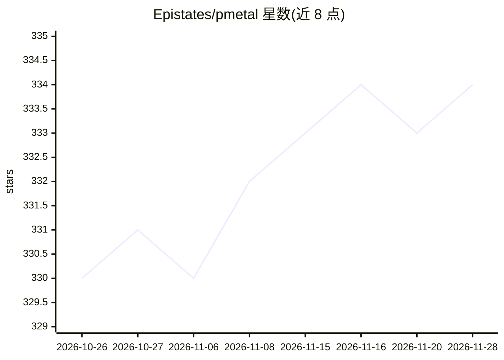

# Epistates/pmetal

⭐ 334 · Rust · NOASSERTION · 推送 2026-11-27 · [GitHub](https://github.com/Epistates/pmetal) · [官网](https://pmetal.io) · 个人维护

**面向 Mac 开发者的 Apple Silicon 本地 LLM 训练、推理与服务框架**

用 Rust 编写的 Apple Silicon 框架，在 Mac 的 GPU（Metal）与 Neural Engine 上训练和运行大语言模型，无 Python/CUDA 参与。功能覆盖 LoRA/QLoRA/DoRA 等全参数微调、GRPO/DPO 等偏好与推理训练、蒸馏、预训练、量化（GGUF/NVFP4/FP8/MXFP4）、投机解码与多 Mac 分布式训练。同一套命令以 CLI、TUI、Tauri 桌面应用、MCP 服务器、Python 绑定和 Rust SDK 六种界面提供，字段由统一 job spec 生成。安装走 Homebrew、预编译二进制或源码构建。

## 筛选速览

| 维度 | 判定 | 备注 |
|---|---|---|
| AI 角色 | `ai-ecosystem` | LLM/agent 周边工具 |
| 许可风险 | `none` | NOASSERTION |
| 部署形态 | `desktop` | 安装包/桌面程序 |
| 模型依赖 | — | README 未给出锁定关系 |
| 硬件要求 | — | 无带数字的原话,不猜 |
| 安装摩擦 | `high` | 编译与系统依赖俱全 |
| 成熟度 | — | 结构信号不足 |

## 能力要点

- LoRA 全家族微调（LoRA/QLoRA/DoRA/rsLoRA/LoRA+/PiSSA/OLoRA/LoftQ），适配器兼容 PEFT 布局
- 单一服务器同时提供 OpenAI 与 Anthropic 两套 API，含工具调用与 JSON-schema 约束输出
- Neural Engine 用于整模型推理与训练路径；MoE 专家可 offload 到 SSD，KV 缓存 2-4 位压缩
- MCP 服务器暴露 57 个工具，供 Claude Desktop/Code 等 MCP 客户端调用

## 适用场景

- 在 Mac 上对开源模型做 LoRA/QLoRA 微调而不依赖云 GPU
- 本地起一个 OpenAI/Anthropic 兼容的推理服务器
- 通过 MCP 让 Claude Desktop 操作训练与推理任务
- 多台 Mac 通过雷雳互联组成训练集群

## 场景标签

`微调` `推理引擎` `模型量化` `模型训练` · 领域:训练与推理

## 证据(README 行号)

> L9: **Powdered Metal**: fine-tuning, inference and serving for Apple Silicon, written in Rust.
> L11: PMetal trains and runs large language models on the Mac's GPU and Neural Engine, with no Python or CUDA in the loop
> L78: |`serve`|OpenAI- and Anthropic-compatible server|

## 星数曲线

2026-10-26 330 → 2026-11-28 334（+4）

---
*卡片 v1 · prompt 1.4 · 生成 2026-11-25 · 置信度 high · 依据 README sha `b2ffce6e843f` · [字段定义](../../DATASET.md)*
