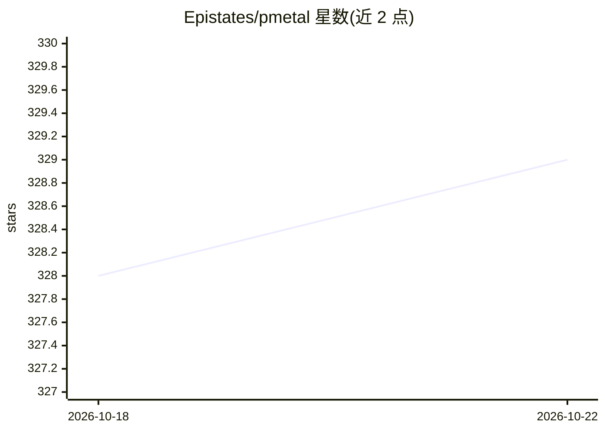

# Epistates/pmetal

⭐ 329 · Rust · NOASSERTION · 推送 2026-10-14 · [GitHub](https://github.com/Epistates/pmetal) · [官网](https://pmetal.io) · 个人维护

**Apple Silicon 本地 LLM 训练与推理的 Rust 框架套件**

面向 Apple Silicon（M1–M5）的 Rust 机器学习平台，覆盖 Metal GPU 内核、Apple Neural Engine 集成、LoRA/QLoRA 微调、全参数预训练、蒸馏、GRPO/DPO 偏好优化、GGUF/MLX 量化、模型合并与 OpenAI/Anthropic 兼容推理服务。交付形态包括 CLI（40+ 子命令）、21 标签页终端 TUI、Tauri+Svelte 桌面 GUI、Rust SDK 与 PyO3 Python SDK，另支持 MCP 服务器（53 工具）与 Thunderbolt 优先的多 Mac 集群分布式训练。限制：仅限 Apple Silicon 硬件；跨机超大模型切分尚在开发中。

## 筛选速览

| 维度 | 判定 | 备注 |
|---|---|---|
| AI 角色 | `ai-ecosystem` | LLM/agent 周边工具 |
| 许可风险 | `none` | NOASSERTION |
| 部署形态 | `desktop` | 安装包/桌面程序 |
| 模型依赖 | local-ok | 支持本地模型 |
| 硬件要求 | — | 无带数字的原话,不猜 |
| 安装摩擦 | `medium` | 含编译或系统依赖之一 |
| 成熟度 | — | 结构信号不足 |

## 能力要点

- LoRA/QLoRA/全参数预训练/蒸馏/GRPO/DPO 等训练能力，CLI+TUI+GUI+SDK 多形态交付
- OpenAI 与 Anthropic 兼容推理服务，支持多模态（图像/视频）请求
- 按芯片型号（M1–M5、Base/Pro/Max/Ultra）自动检测并调优内核参数
- Thunderbolt 优先的多 Mac 集群：mDNS 发现、梯度 all-reduce 与压缩传输

## 适用场景

- 在 Mac 上对 Qwen/Llama/Gemma 等模型做 LoRA/QLoRA 微调与量化
- 本地运行 OpenAI/Anthropic 兼容推理服务并与现有客户端对接
- 把训练/推理能力嵌入自己的 Rust 或 Python 应用
- 用多台 Mac 组成集群做分布式训练

## 场景标签

`微调` `模型训练` `推理引擎` `模型量化` · 领域:训练与推理

## 证据(README 行号)

> L8: **Powdered Metal** — An ML SDK, framework, and application suite for Apple Silicon, written in Rust.
> L10: PMetal is a complete machine learning platform for Apple Silicon — from low-level Metal GPU kernels and Apple Neura
> L141: `orchestrator::run_training` is the one-call training entry point the CLI itself uses:

## 星数曲线

2026-10-18 328 → 2026-10-22 329（+1）

---
*卡片 v1 · prompt 1.4 · 生成 2026-10-21 · 置信度 high · 依据 README sha `b14008fea436` · [字段定义](../../DATASET.md)*
