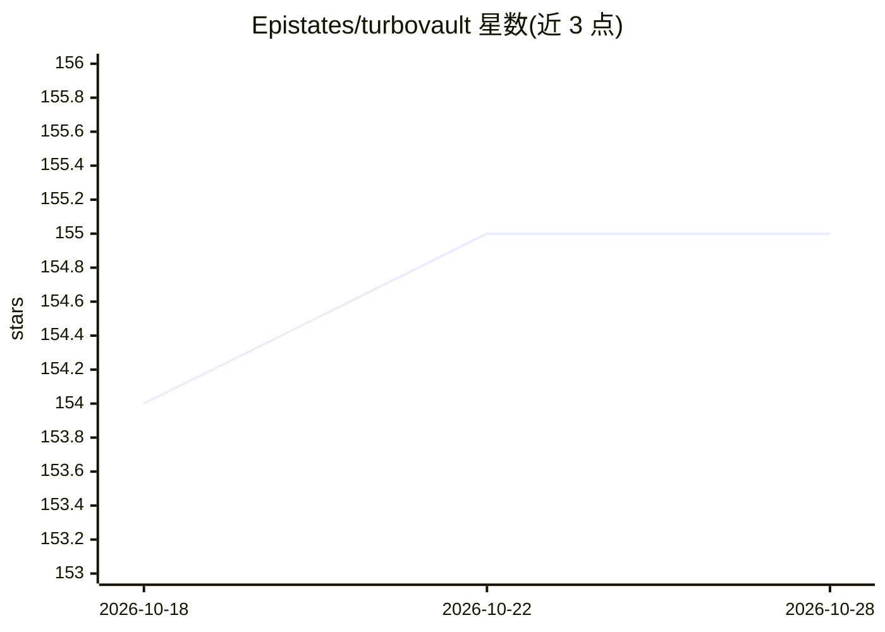

# Epistates/turbovault

⭐ 155 · Rust · MIT · 推送 2026-10-24 · [GitHub](https://github.com/Epistates/turbovault) · 个人维护

**让 AI agent 安全读写 Obsidian 笔记库的 MCP 服务器与 Rust crate**

TurboVault 是一个单一二进制的 MCP 服务器，配套一组处理 Obsidian Flavored Markdown 的 Rust crate，为 AI agent 提供对 Obsidian vault 的读写访问。写入统一走原子重命名（hash 前置条件）或 Git 后端（每次写一个提交），移动笔记时同步改写指向它的各类链接；搜索/图谱/相似度结果服务前先对比并增量更新索引，覆盖外部编辑与云同步场景。提供约 40 个工具（搜索、链接图谱、SQL 查询 frontmatter、canvas、任务、审计回滚等）及安全边界（vault 注册受限、网络传输需认证、只读模式）。安装方式为 GitHub 预编译二进制、cargo install 或 Docker。

## 筛选速览

| 维度 | 判定 | 备注 |
|---|---|---|
| AI 角色 | `ai-ecosystem` | LLM/agent 周边工具 |
| 许可风险 | `permissive` | MIT |
| 部署形态 | `self-host` | docker 或自建部署 |
| 模型依赖 | — | README 未给出锁定关系 |
| 硬件要求 | — | 无带数字的原话,不猜 |
| 安装摩擦 | `low` | 无编译、无系统依赖或容器化 |
| 成熟度 | — | 结构信号不足 |

## 能力要点

- 单一二进制、无运行时依赖，含 40 余个知识库操作工具
- 直连后端原子重命名+hash 前置条件，Git 后端每次写入对应一个提交
- 写入统一路径：移动笔记时改写 wikilinks/Markdown 链接/canvas 引用
- hash 链审计日志、按操作 ID 回滚、vault 注册与网络传输的安全限制

## 适用场景

- 让 Claude 等 agent 客户端安全读写我的 Obsidian 笔记库
- 通过 MCP 对笔记库做搜索、图谱分析和 frontmatter SQL 查询
- 用 Git 后端保证 agent 批量修改可审计、可回滚
- 在 CI 中用 okf_validate 校验知识库格式

## 场景标签

`知识库管理` · 领域:知识与检索

## 证据(README 行号)

> L11: TurboVault is an MCP server that gives AI agents safe, fast access to Obsidian vaults, and a set of Rust crates for
> L13: - **Writes you can trust.** Every change goes through one write path: atomic renames with hash preconditions on a p
> L16: - **Built for agents.** Every tool has parameter descriptions, annotations, a typed output schema, paged results an

## 星数曲线

2026-10-18 154 → 2026-10-28 155（+1）

---
*卡片 v1 · prompt 1.4 · 生成 2026-10-22 · 置信度 high · 依据 README sha `375e1864a973` · [字段定义](../../DATASET.md)*
