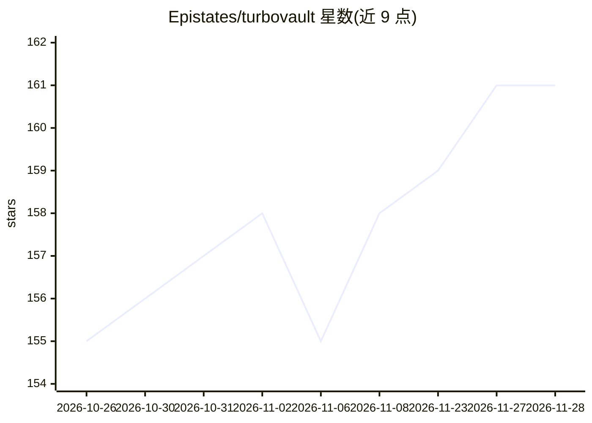

# Epistates/turbovault

⭐ 161 · Rust · MIT · 推送 2026-11-26 · [GitHub](https://github.com/Epistates/turbovault) · 个人维护

**给 AI agent 提供安全读写 Obsidian 笔记库的 MCP 服务器**

Rust 编写的 MCP 服务器加一组处理 Obsidian Flavored Markdown 的 crate，以单二进制形态运行，无运行时依赖。为 AI agent 提供笔记读写、全文搜索、链接图谱、相似度、frontmatter SQL、canvas/任务/周期笔记等 40 余个工具；写入走原子重命名加哈希前置条件或 Git 提交路径，服务前比对增量索引，破坏性操作在客户端支持时请求用户确认，并带审计日志与回滚。提供预编译二进制、cargo 安装与 Docker 镜像。

## 筛选速览

| 维度 | 判定 | 备注 |
|---|---|---|
| AI 角色 | `ai-ecosystem` | LLM/agent 周边工具 |
| 许可风险 | `permissive` | MIT |
| 部署形态 | `self-host` | docker 或自建部署 |
| 模型依赖 | — | README 未给出锁定关系 |
| 硬件要求 | — | 无带数字的原话,不猜 |
| 安装摩擦 | `low` | 无编译、无系统依赖或容器化 |
| 成熟度 | — | 结构信号不足 |

## 能力要点

- 40+ MCP 工具：笔记读写、BM25 搜索、链接图谱、相似度、frontmatter SQL
- 单二进制无运行时依赖，原子写入/每次写入一个 Git 提交，含审计日志与回滚
- 服务前比对增量，可感知 Obsidian、同步客户端或 git pull 造成的外部编辑
- 安全机制：路径限制、受保护目录、网络传输认证、read-only 档位

## 适用场景

- 让 Claude Desktop/Code 等 MCP 客户端直接读写和管理我的 Obsidian 笔记库
- 用 agent 做笔记库的断链修复、质量体检与结构分析
- 在 Git 支持的库上让 agent 批量改写并保持链接一致

## 场景标签

`知识库管理` · 领域:知识与检索

## 证据(README 行号)

> L11: TurboVault is an MCP server that gives AI agents safe, fast access to Obsidian vaults, and a set of Rust crates for
> L16: - **Built for agents.** Every tool has parameter descriptions, annotations, a typed output schema, paged results an

## 星数曲线

2026-10-26 155 → 2026-11-28 161（+6）

---
*卡片 v1 · prompt 1.4 · 生成 2026-11-28 · 置信度 high · 依据 README sha `f4f9cb263ae7` · [字段定义](../../DATASET.md)*
