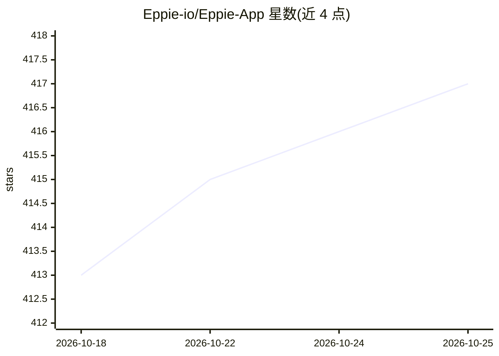

# Eppie-io/Eppie-App

⭐ 417 · C# · Apache-2.0 · 推送 2026-10-23 · [GitHub](https://github.com/Eppie-io/Eppie-App) · [官网](https://eppie.io) · 组织维护

**无服务器的加密点对点邮件客户端，支持现有邮箱账户**

跨平台（Windows/macOS/Linux，移动端开发中）邮件客户端，目标是以 BIP39 助记词创建本地账户、基于椭圆曲线加密实现端到端加密的点对点邮件，并通过自有 p2p 网络与比特币、以太坊等去中心化网络通信。稳定版目前作为常规邮件客户端运行，兼容 Gmail、Outlook 等 IMAP/SMTP 服务商，支持 PGP 加密与加密本地备份；去中心化功能仅在 Testnet 构建中以实验形式提供，由 Eppie-io 团队以 C#/Uno 开发。

## 筛选速览

| 维度 | 判定 | 备注 |
|---|---|---|
| AI 角色 | `ai-enhanced` | 去掉 AI 部分产品仍成立 |
| 许可风险 | `permissive` | Apache-2.0 |
| 部署形态 | `desktop` | 安装包/桌面程序 |
| 模型依赖 | — | README 未给出锁定关系 |
| 硬件要求 | — | 无带数字的原话,不猜 |
| 安装摩擦 | `low` | 无编译、无系统依赖或容器化 |
| 成熟度 | `idea` | |

## 能力要点

- 以 BIP39 助记词创建本地账户，数据由私钥持有者独占
- 兼容 Gmail/Outlook 等主流邮箱，可在 Proton Mail 服务器认证
- 支持 PGP 加密与加密本地备份
- Testnet 构建提供基于比特币 Testnet4 地址的端到端加密邮件实验功能

## 适用场景

- 在不依赖服务商服务器的架构下收发加密邮件
- 继续使用 Gmail/Outlook 账户并获得额外加密与本地备份
- 通过 Testnet 构建体验去中心化邮件实验功能

## 场景标签

 · 领域:通信/邮件

## 证据(README 行号)

> L13: Eppie is a next-gen _providerless_ email that allows its users to own their accounts, addresses and data. In additi
> L130: At launch Eppie will store the data using IPFS infrastructure, and the transport layer will work through SBBS. Wit

## 星数曲线

2026-10-18 413 → 2026-10-25 417（+4）

---
*卡片 v1 · prompt 1.4 · 生成 2026-10-21 · 置信度 low · 依据 README sha `fbbfffc3a426` · [字段定义](../../DATASET.md)*
