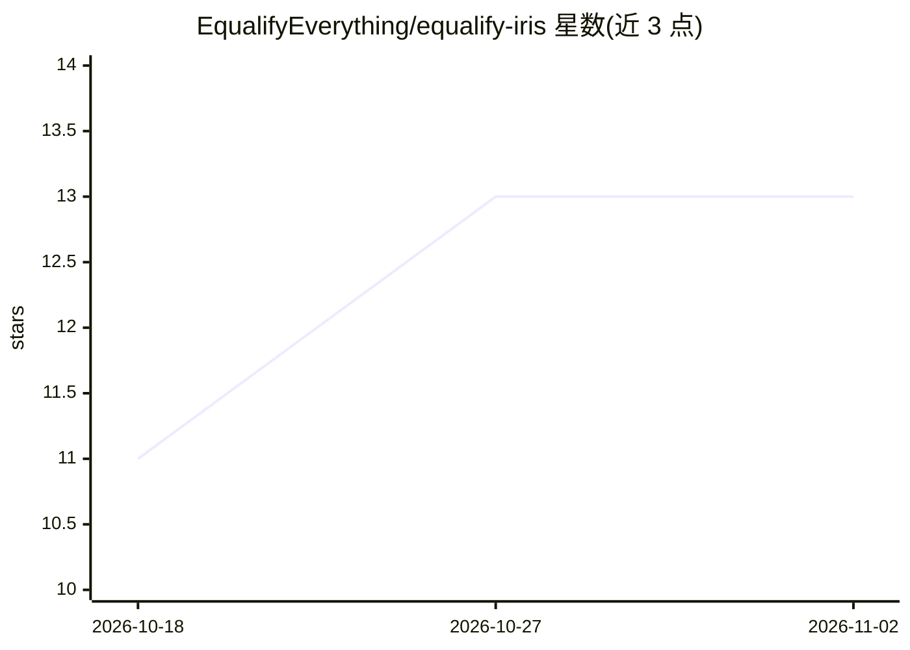

# EqualifyEverything/equalify-iris

⭐ 13 · TypeScript · AGPL-3.0 · 推送 2026-10-30 · [GitHub](https://github.com/EqualifyEverything/equalify-iris) · [官网](https://philosophers.group/iris-beyond-solving-blindness/) · 组织维护

**将 PDF 页面经视觉模型转为 WCAG 2.2 AA 可访问 HTML**

Iris 把 PDF 各页交给视觉模型读取，结合可改进的提示词生成一份满足 WCAG 2.2 AA 的语义化 HTML 文档，再由 reader 与 copy editor 两类 agent 审阅修订。仅输出内容不含样式，可选 equalify-iris-pdf 回写带标签的 PDF。单机即可运行（模型、SQLite 与本地文件存储由配置指定），提供浏览器界面、REST API 与命令行转换三种使用方式；无登录机制，靠 server.api_token 控制访问。安装需 Node.js 24.15+、git 与 poppler-utils，也提供多架构 Docker 镜像。

## 筛选速览

| 维度 | 判定 | 备注 |
|---|---|---|
| AI 角色 | `ai-native` | 本体是模型或模型工具 |
| 许可风险 | `viral` | AGPL-3.0 |
| 部署形态 | `library` | 以包/库形式分发 |
| 模型依赖 | — | README 未给出锁定关系 |
| 硬件要求 | — | 无带数字的原话,不猜 |
| 安装摩擦 | `low` | 无编译、无系统依赖或容器化 |
| 成熟度 | — | 结构信号不足 |

## 能力要点

- 视觉模型逐页读取 PDF，生成 WCAG 2.2 AA 语义化 HTML
- reader 与 copy editor 两类 agent 审阅并修正全文
- 浏览器界面、REST API（OpenAPI 文档）与 npm run convert 命令行三种使用途径
- 提供多架构 Docker 镜像（Mac Mini / Linux ARM 为一级目标）

## 适用场景

- 把扫描或排版复杂的 PDF 转成屏幕阅读器可用的 HTML
- 配合 WordPress 插件或 Drupal 模块发布无障碍内容
- 自托管部署后通过 API 批量处理文档转换

## 场景标签

`文档解析` · 领域:知识与检索

## 证据(README 行号)

> L3: Iris turns the pages of a PDF into one accessible HTML document that meets WCAG 2.2 AA. A vision
> L4: model reads each page, using prompts anyone can improve. Then a reader and a copy editor review the

## 星数曲线

2026-10-18 11 → 2026-11-02 13（+2）

---
*卡片 v1 · prompt 1.4 · 生成 2026-10-31 · 置信度 high · 依据 README sha `8a2ccf7b7a87` · [字段定义](../../DATASET.md)*
