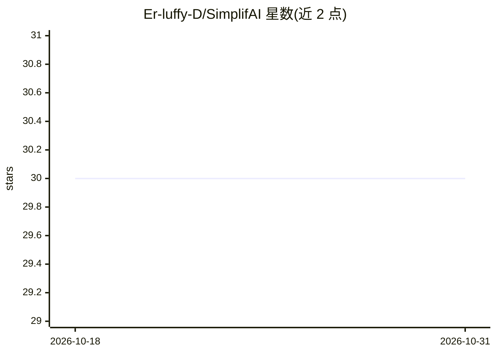

# Er-luffy-D/SimplifAI

⭐ 30 · TypeScript · MIT · 推送 2026-07-05 · [GitHub](https://github.com/Er-luffy-D/SimplifAI) · [官网](https://simplif-ai-xi.vercel.app) · 个人维护

**AI 学习平台：把文档转成摘要、闪卡与测验**

基于 Next.js 14、React、Tailwind CSS 的开源 Web 应用，面向学生、教师与自学者：上传 PDF/TXT 文档后，通过 DeepSeek/OpenRouter API 生成摘要、要点、闪卡和测验。认证采用 NextAuth.js（凭据与 Google 登录），数据库为 PostgreSQL 配 Prisma ORM；文件处理后不永久存储。路线图中 RAG 文档对话、更多文件格式与团队/企业功能尚未完成。提供本地开发与 Docker 运行方式，MIT 许可，接受社区贡献。

## 筛选速览

| 维度 | 判定 | 备注 |
|---|---|---|
| AI 角色 | `ai-native` | 本体是模型或模型工具 |
| 许可风险 | `permissive` | MIT |
| 部署形态 | `library` | 以包/库形式分发 |
| 模型依赖 | locked-api |  |
| 硬件要求 | — | 无带数字的原话,不猜 |
| 安装摩擦 | `low` | 无编译、无系统依赖或容器化 |
| 成熟度 | — | 结构信号不足 |

## 能力要点

- 上传 PDF/TXT 生成 AI 摘要、闪卡与测验
- NextAuth.js 认证（凭据与 Google）
- 文件处理后不永久存储
- Docker 本地运行方式

## 适用场景

- 把课程文档快速转成闪卡和测验来复习
- 生成文档摘要提取要点辅助学习
- 教师用测验检验学生对材料的理解

## 场景标签

`AI 写作` · 领域:内容生成

## 证据(README 行号)

> L4: Transform your documents into flashcards, summaries, and quizzes with cutting-edge AI.
> L19: - **Get** AI-generated summaries, key points, flashcards, and quizzes

## 星数曲线

2026-10-18 30 → 2026-10-31 30（+0）

---
*卡片 v1 · prompt 1.4 · 生成 2026-10-26 · 置信度 high · 依据 README sha `46549215641e` · [字段定义](../../DATASET.md)*
