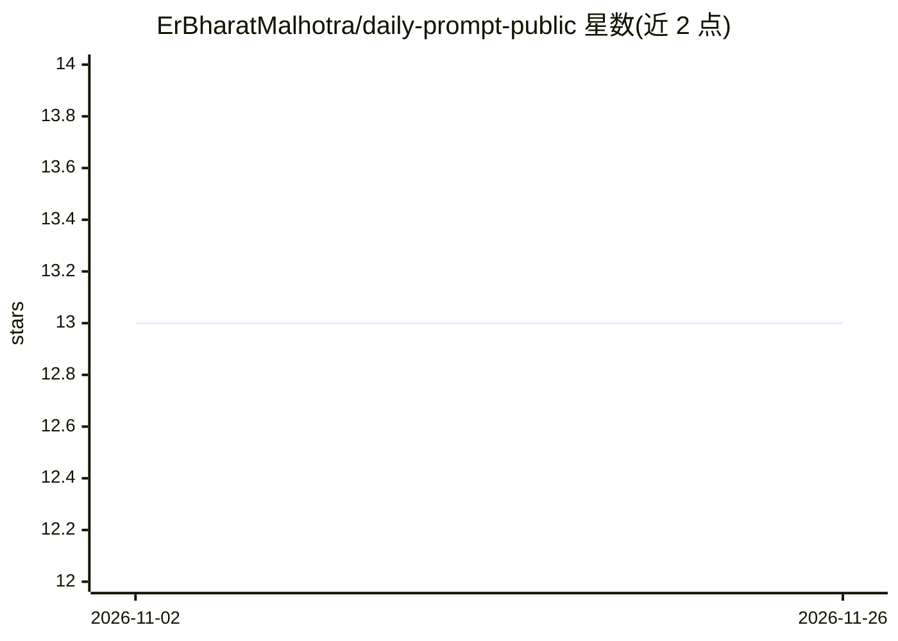

# ErBharatMalhotra/daily-prompt-public

⭐ 13 · JavaScript · 推送 2026-11-25 · [GitHub](https://github.com/ErBharatMalhotra/daily-prompt-public) · [官网](https://news.bharatdn.com) · 个人维护

**无人值守的自主 AI 报纸：每日自动采集、写作、事实把关并发布**

以 GitHub Actions 驱动的自动新闻流水线：每天 06:00 IST 扫描 28 个 RSS 源，模糊去重后由 8 个分栏目 AI 记者撰写原创文章，AI 编辑对每篇草稿做事实打分，含编造引语或数字的稿件进入隔离区不予发布。构建为静态站点并部署到 Cloudflare Pages，附带 PWA 安装、Web Push 通知、Telegram 摘要与公开运行遥测。LLM 调用按 Groq→Gemini→OpenRouter 链路降级并共享每日预算。引擎源码在私有仓库，本仓库公开工作流与构建产物，复刻需按 SETUP.md 配置。

## 筛选速览

| 维度 | 判定 | 备注 |
|---|---|---|
| AI 角色 | `ai-native` | 本体是模型或模型工具 |
| 许可风险 | `permissive` | — |
| 部署形态 | `None` |  |
| 模型依赖 | — | README 未给出锁定关系 |
| 硬件要求 | — | 无带数字的原话,不猜 |
| 安装摩擦 | `low` | 无编译、无系统依赖或容器化 |
| 成熟度 | — | 结构信号不足 |

## 能力要点

- 事实把关发布门：编造引语/数字的稿件被隔离，禁止发布
- 8 个分栏目 AI 记者各持演化 prompt-genome，每周变异并 A/B 竞选
- Groq→Gemini→OpenRouter 多供应商降级链与共享每日预算
- git 作为数据库：每期版面与隔离档案持久化提交

## 适用场景

- 自动运营一个无人值守的新闻聚合与原创写作站点
- 研究带事实校验门的多 agent 内容生产流水线
- 搭建零后端、可安装 PWA 并支持 Web Push 的阅读产品

## 场景标签

`多智能体` `工作流自动化` `AI 写作` · 领域:Agent 开发

## 证据(README 行号)

> L8: **Every morning, without any human touching a keyboard, this system reads the news, writes its own newspaper, fact-c
> L18: |**3 · Write**|8 AI journalists — one per section, each with its own **evolving prompt-genome** — draft original ar
> L40: - Multi-provider LLM chain with circuit breakers (Groq → Gemini → OpenRouter), shared daily budget, per-call fallba

## 星数曲线

2026-11-02 13 → 2026-11-26 13（+0）

---
*卡片 v1 · prompt 1.4 · 生成 2026-11-18 · 置信度 high · 依据 README sha `9f8859e3277c` · [字段定义](../../DATASET.md)*
