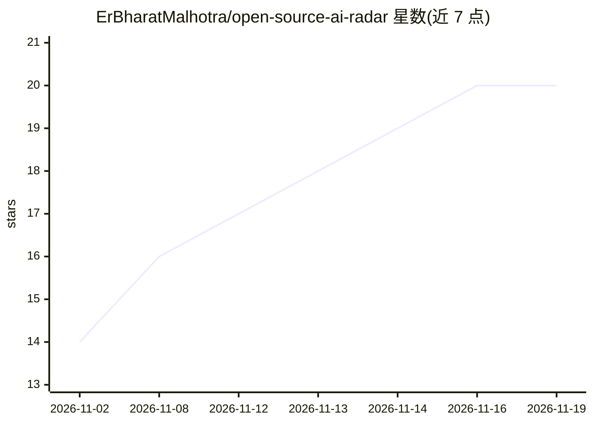

# ErBharatMalhotra/open-source-ai-radar

⭐ 20 · Python · MIT · 推送 2026-11-18 · [GitHub](https://github.com/ErBharatMalhotra/open-source-ai-radar) · [官网](https://radar.bharatdn.com) · 个人维护

**开源 AI 仓库追踪平台：10,438 个仓库的三轴评分与趋势发现**

持续更新的开源 AI 项目情报平台：通过 GitHub API 按主题、关键词、趋势和自由文本四层发现机制收录 10,438 个仓库，自动分类到 11 个 AI 类别，并以 Impact(40%)/Velocity(35%)/Health(25%) 三轴加权计算 Radar Score，每日 6 次由 GitHub Actions 刷新。提供 9,000+ 项目页面的 Astro 静态网站、JSON/CSV/RSS API、徽章、周报与社媒草稿生成，分类可用规则或可选 LLM（Ollama/OpenAI/GitHub Models）执行，默认规则路径免费。

## 筛选速览

| 维度 | 判定 | 备注 |
|---|---|---|
| AI 角色 | `ai-knowledge` | 知识聚合/清单类 |
| 许可风险 | `permissive` | MIT |
| 部署形态 | `None` |  |
| 模型依赖 | local-ok | 支持本地模型 |
| 硬件要求 | — | 无带数字的原话,不猜 |
| 安装摩擦 | `low` | 无编译、无系统依赖或容器化 |
| 成熟度 | — | 结构信号不足 |

## 能力要点

- 三轴评分（Impact/Velocity/Health）+ 历史追踪与突发检测
- 四层自动发现机制，收录 10,438 个仓库、11 个 AI 类别
- 分层调度：按星标分级以不同频率处理（T1 每日至 T4 每月）
- 提供 JSON/CSV/RSS API、动态徽章与 llms.txt 机器可读数据

## 适用场景

- 发现正在上升期而非仅看星标数的开源 AI 项目
- 对比 2-3 个候选仓库的三轴评分与 90 天历史
- 通过 RSS/API 订阅或程序化获取 AI 项目趋势数据

## 场景标签

 · 领域:开发者工具/AI 生态分析

## 证据(README 行号)

> L7: Open Source AI Radar is a **continuously updated intelligence platform** that discovers, analyzes, scores, and track
> L13: **Tracking 10,438 repos · 75% auto-classified into 11 AI categories · 44.7M stars tracked · Updated 2026-11-17 23:3
> L27: - **Static Website** — 9,000+ project pages, search, filter, explore rankings, side-by-side comparison, and weekly 

## 星数曲线

2026-11-02 14 → 2026-11-19 20（+6）

---
*卡片 v1 · prompt 1.4 · 生成 2026-11-18 · 置信度 high · 依据 README sha `20e7286f4ec7` · [字段定义](../../DATASET.md)*
