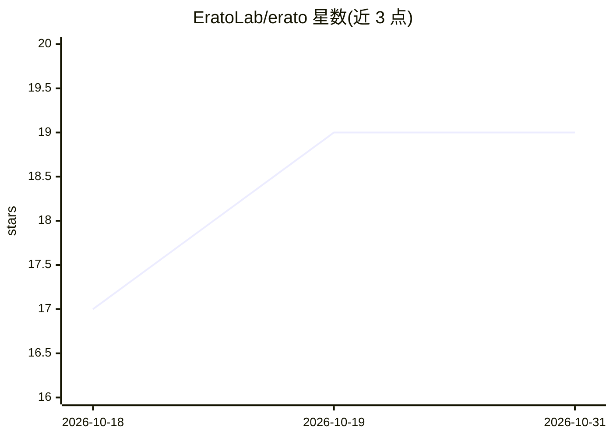

# EratoLab/erato

⭐ 19 · TypeScript · AGPL-3.0 · 推送 2026-10-30 · [GitHub](https://github.com/EratoLab/erato) · [官网](https://erato.chat/) · 组织维护

**开源自托管 AI 聊天平台，面向私有化部署**

名为 Erato 的开源 AI 平台，主打私有化/自托管部署，附带 Helm chart，面向需要本地运行 AI 聊天服务的团队。支持多种 SSO 提供商做认证，可通过 MCP 服务器扩展自定义集成，并宣称资源占用较小。以 Rust 构建，采用 AGPL-3.0-only 许可证分发。README 信息较简略，仅给出克隆仓库的开发设置方式，未展示具体的模型接入与功能细节。

## 筛选速览

| 维度 | 判定 | 备注 |
|---|---|---|
| AI 角色 | `ai-native` | 本体是模型或模型工具 |
| 许可风险 | `viral` | AGPL-3.0 |
| 部署形态 | `library` | 以包/库形式分发 |
| 模型依赖 | — | README 未给出锁定关系 |
| 硬件要求 | — | 无带数字的原话,不猜 |
| 安装摩擦 | `low` | 无编译、无系统依赖或容器化 |
| 成熟度 | — | 结构信号不足 |

## 能力要点

- 面向自托管部署，附带 Helm chart
- 支持多种 SSO 提供商
- 可通过 MCP 服务器扩展自定义集成
- Rust 构建，AGPL-3.0-only 许可

## 适用场景

- 在企业内网私有化部署 AI 聊天服务
- 通过 SSO 接入企业统一认证后使用
- 借助 MCP 服务器扩展自有工具集成

## 场景标签

`聊天机器人` · 领域:对话与助手

## 证据(README 行号)

> L3:  Erato - AI that fits in
> L10: - 🚀 Built for self-hosted deployments (Helm charts included)

## 星数曲线

2026-10-18 17 → 2026-10-31 19（+2）

---
*卡片 v1 · prompt 1.4 · 生成 2026-10-29 · 置信度 mid · 依据 README sha `a59a91397a95` · [字段定义](../../DATASET.md)*
