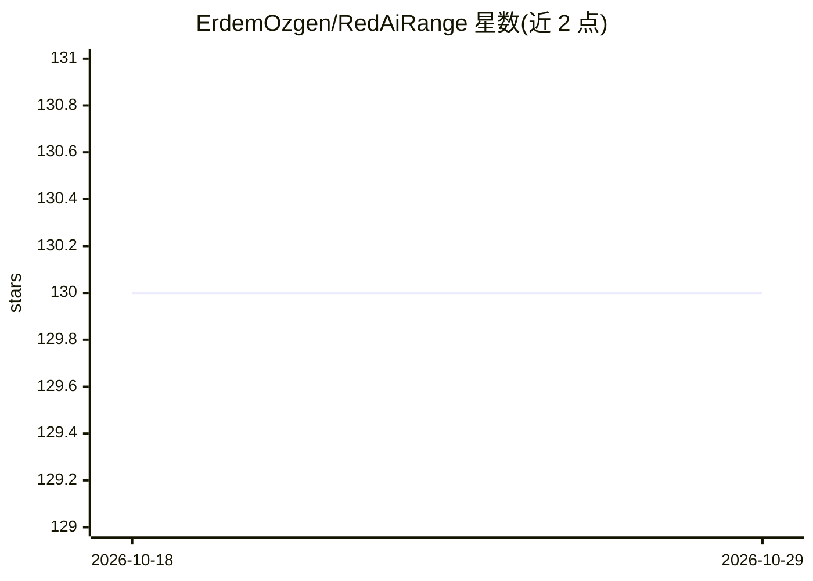

# ErdemOzgen/RedAiRange

⭐ 130 · Jupyter Notebook · MIT · 推送 2026-07-01 · [GitHub](https://github.com/ErdemOzgen/RedAiRange) · 个人维护

**AI 安全红队训练与评估平台：容器化靶场测试 AI 系统**

以 Docker 容器方式运行的 AI 安全评估平台，面向红队、漏洞研究与防御验证。通过挂载 Docker socket 管理场景容器，提供 Arsenal（安全工具）/Target（易受攻击 AI 靶机）/Compose 三种部署模式，内置对抗样本、投毒、模型窃取、隐私攻击、GenAI 靶机等预定义场景，每个场景经 Jupyter Notebook 提供实验材料。支持远程 Agent 接入分布式节点（含 GPU 机器）、会话视频录制与五模块训练课程。默认监听 localhost:5002。

## 筛选速览

| 维度 | 判定 | 备注 |
|---|---|---|
| AI 角色 | `ai-ecosystem` | LLM/agent 周边工具 |
| 许可风险 | `permissive` | MIT |
| 部署形态 | `self-host` | docker 或自建部署 |
| 模型依赖 | — | README 未给出锁定关系 |
| 硬件要求 | — | 无带数字的原话,不猜 |
| 安装摩擦 | `low` | 无编译、无系统依赖或容器化 |
| 成熟度 | — | 结构信号不足 |

## 能力要点

- Docker-in-Docker 场景容器管理与快速重置
- Arsenal/Target/Compose 三种部署模式
- 预定义 AI 攻击场景（投毒/逃逸/隐私/模型篡改等）附带 Jupyter 材料
- 远程 Agent 支持分布式团队与 GPU 基础设施
- 会话视频录制与时间戳活动追踪

## 适用场景

- 安全团队在受控环境验证 AI 攻击向量与 PoC
- 企业在 AI 系统上线前做安全测试与周期性验证
- 培训机构开展 AI 安全实验课与工作坊

## 场景标签

`网络安全` `教程课程` · 领域:学习与行业

## 证据(README 行号)

> L3: Red AI Range is a professional platform for AI security assessment, AI red team operations, and vulnerability resear
> L79: The platform runs as a Docker container and manages scenario containers through the mounted Docker socket. This mod

## 星数曲线

2026-10-18 130 → 2026-10-29 130（+0）

---
*卡片 v1 · prompt 1.4 · 生成 2026-10-23 · 置信度 mid · 依据 README sha `0b85bf3ba275` · [字段定义](../../DATASET.md)*
