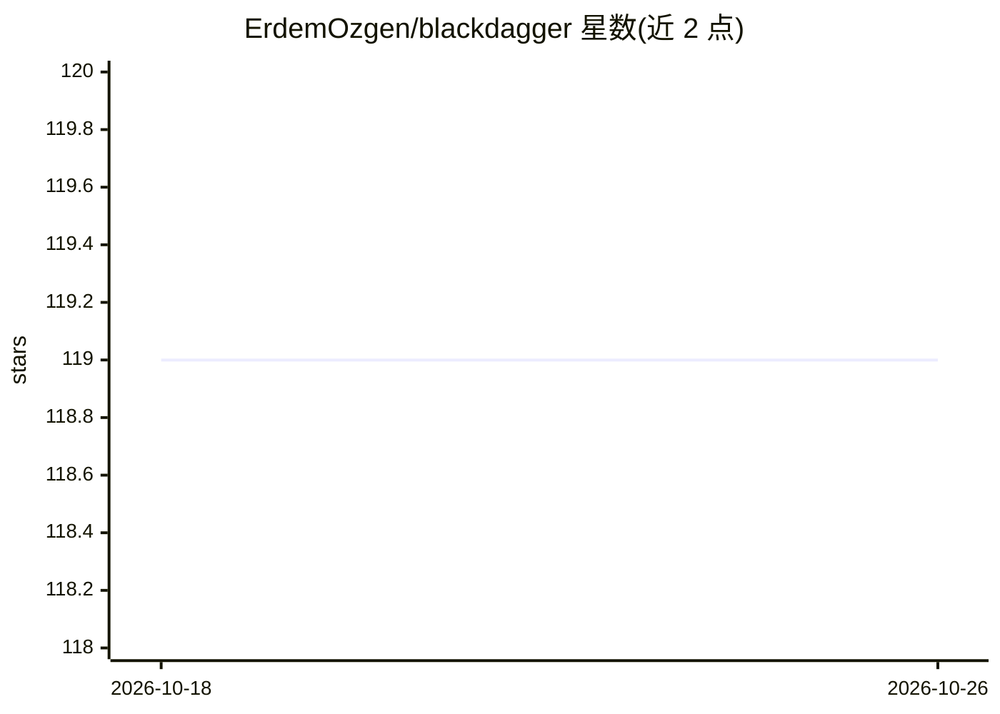

# ErdemOzgen/blackdagger

⭐ 119 · Go · GPL-3.0 · 推送 2026-06-21 · [GitHub](https://github.com/ErdemOzgen/blackdagger) · [官网](https://blackdagger.readthedocs.io/) · 个人维护

**面向 DevOps/DevSecOps/CART 的 YAML DAG 工作流编排工具**

以 YAML 声明式 DAG 定义工作流的自动化编排工具，服务 DevOps、DevSecOps、MLOps、MLSecOps 与持续自动化红队（CART）场景。提供 Web UI 与 CLI 管理执行 DAG，支持 Docker 容器、HTTP 请求、SSH 远程命令、jq、邮件等执行器，含 Cron 调度、自动重试、REST API 与 HTTPS 基本认证。配套 5 组件框架：Blackcart 镜像、预测试 YAML 库、GitHub Actions 基础设施、浏览器扩展。安装方式含脚本、Docker Compose 与 Releases 二进制；部分工作流需 sudo 权限。框架含名为 GPT4 的 YAML Creator 辅助生成配置，本体非 AI 产品。DevOps/MLOps/MLSecOps 类示例 YAML 标注 TBU 待补。

## 筛选速览

| 维度 | 判定 | 备注 |
|---|---|---|
| AI 角色 | `ai-enhanced` | 去掉 AI 部分产品仍成立 |
| 许可风险 | `viral` | GPL-3.0 |
| 部署形态 | `desktop` | 安装包/桌面程序 |
| 模型依赖 | — | README 未给出锁定关系 |
| 硬件要求 | — | 无带数字的原话,不猜 |
| 安装摩擦 | `low` | 无编译、无系统依赖或容器化 |
| 成熟度 | — | 结构信号不足 |

## 能力要点

- YAML 声明式 DAG 定义工作流，免脚本编排任务依赖
- Web UI 与 CLI 双入口，实时状态、日志与重跑
- 执行器覆盖 Docker、HTTP、SSH、jq、邮件，支持 Cron 调度与自动重试
- 五组件框架（Blackcart/示例 YAML/GitHub Infra/Web Kit）面向 CART 与 DevSecOps

## 适用场景

- 定时调度 ETL 数据管道并集中处理数据
- 通过 HTTP/SSH 周期性巡检基础设施组件
- 以预置 YAML 执行持续自动化红队与 DevSecOps 流程
- 自动生成并发送周期性报告邮件

## 场景标签

`工作流自动化` · 领域:效率与自动化

## 证据(README 行号)

> L32: Installation | Quick Start Docs | Blackdagger YAML Creator GPT4
> L36: Blackdagger is a powerful, user-friendly framework designed to orchestrate complex workflows in DevOps, DevSecOps, 

## 星数曲线

2026-10-18 119 → 2026-10-26 119（+0）

---
*卡片 v1 · prompt 1.4 · 生成 2026-10-23 · 置信度 mid · 依据 README sha `4fac71ea2c59` · [字段定义](../../DATASET.md)*
