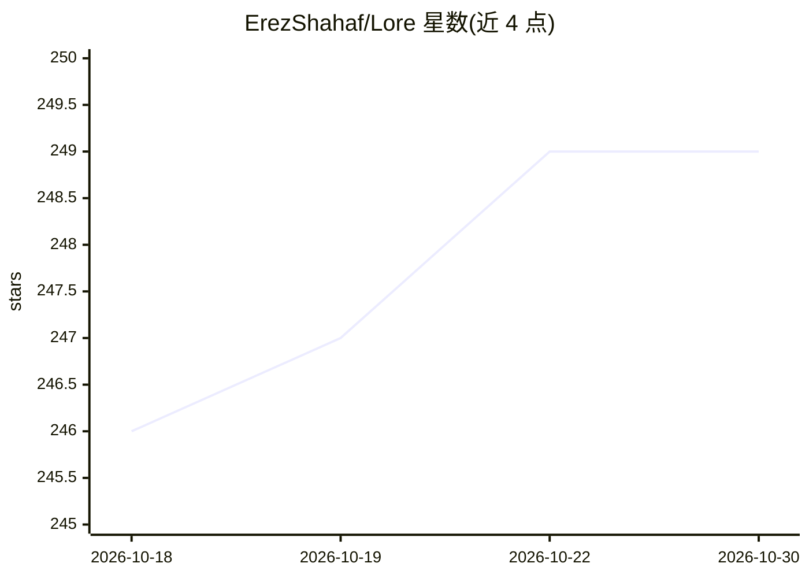

# ErezShahaf/Lore

⭐ 249 · TypeScript · MIT · 推送 2026-04-20 · [GitHub](https://github.com/ErezShahaf/Lore) · 个人维护

**本地优先的桌面速记与回忆应用：Ollama+LanceDB 私人第二记忆**

常驻系统托盘的桌面应用，通过全局快捷键弹出悬浮聊天条快速捕获想法、todo、URL 等内容。内置本地 LLM（经 Ollama 运行）与本地向量数据库 LanceDB，输入被自动分类为想法/问题/命令/指令，问答时以 RAG 检索已存内容生成回答，支持自然语言管理 todo 与设置常驻指令。数据与 AI 处理全部在本机完成，无需云服务与 API key。长期目标是基于积累内容充当个人 agent 的基础，该部分 README 自述仍处于早期。提供 Windows/macOS/Linux 安装包。

## 筛选速览

| 维度 | 判定 | 备注 |
|---|---|---|
| AI 角色 | `ai-native` | 本体是模型或模型工具 |
| 许可风险 | `permissive` | MIT |
| 部署形态 | `desktop` | 安装包/桌面程序 |
| 模型依赖 | local-ok | 支持本地模型 |
| 硬件要求 | — | 无带数字的原话,不猜 |
| 安装摩擦 | `low` | 无编译、无系统依赖或容器化 |
| 成熟度 | `idea` | |

## 能力要点

- 全局快捷键唤起的快速捕获悬浮窗
- 本地 LLM（Ollama）+ 本地向量库（LanceDB），零云依赖
- RAG 检索已存笔记后生成带上下文的回答
- 输入自动分类（想法/问题/命令/指令）与自然语言 todo 管理

## 适用场景

- 随手记录想法、todo、调试命令等并按自然语言检索
- 用自己的话描述问题，从个人笔记中获得有出处的回答
- 在不上云的前提下维护可对话检索的私人知识库

## 场景标签

`知识库管理` `RAG` · 领域:知识与检索

## 证据(README 行号)

> L14: Lore is a lightweight desktop app that sits in your system tray and lets you pop-up a hover chat with a button clic
> L3:  AI-powered thought capture and recall — runs entirely on your machine.

## 星数曲线

2026-10-18 246 → 2026-10-30 249（+3）

---
*卡片 v1 · prompt 1.4 · 生成 2026-10-22 · 置信度 mid · 依据 README sha `bc494275f698` · [字段定义](../../DATASET.md)*
