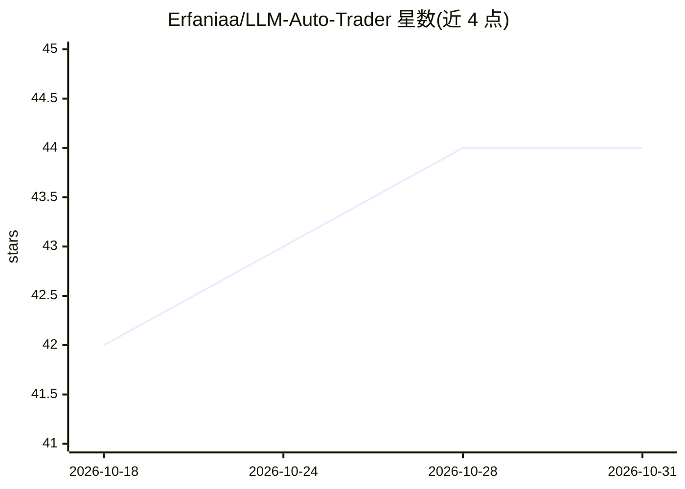

# Erfaniaa/LLM-Auto-Trader

⭐ 44 · Python · NOASSERTION · 推送 2026-07-21 · [GitHub](https://github.com/Erfaniaa/LLM-Auto-Trader) · 个人维护

**LLM 决策的加密货币自动交易机器人（纸面交易优先）**

基于 CCXT 的自动化加密货币交易机器人：周期性拉取多交易所 OHLCV、订单簿、资金费率、链上与情绪等数据组装上下文，交由 LLM 输出结构化 JSON 交易建议，再经确定性风险层（杠杆上限、回撤熔断、费用预算等）校验后执行或模拟。支持任意 CCXT 交易所与 Anthropic/OpenAI/Google/OpenAI 兼容（Ollama、vLLM 等）多种 LLM。默认纸面模式无需交易所密钥；README 详细列出 token 成本估算与降本开关，面向研究与教育用途，声明非投资建议。

## 筛选速览

| 维度 | 判定 | 备注 |
|---|---|---|
| AI 角色 | `ai-native` | 本体是模型或模型工具 |
| 许可风险 | `none` | NOASSERTION |
| 部署形态 | `library` | 以包/库形式分发 |
| 模型依赖 | local-ok | 支持本地模型 |
| 硬件要求 | — | 无带数字的原话,不猜 |
| 安装摩擦 | `low` | 无编译、无系统依赖或容器化 |
| 成熟度 | — | 结构信号不足 |

## 能力要点

- LLM 提议、确定性风险层裁决的两层架构
- 任意 CCXT 交易所 + 多 LLM 提供商（含本地 Ollama/vLLM）
- 默认纸面交易模式，无需交易所密钥
- 每日/每月 LLM 预算硬停与 Telegram 通知

## 适用场景

- 在纸面模式下测试 LLM 驱动的交易策略
- 接入自选交易所与 LLM 模型运行自动交易
- 量化研究者评估 LLM 决策质量与成本权衡

## 场景标签

`金融量化` · 领域:学习与行业

## 证据(README 行号)

> L35: 3. **Asks the LLM**: "given all this, what should I do right now?" The LLM
> L49: Two-layer architecture: the **LLM decides**, the **rules enforce**. If the
> L120: |OpenAI-compatible|`openai-compat`|anything served via `/v1/chat/completions`|Local: Ollama, vLLM, LM Studio. Host

## 星数曲线

2026-10-18 42 → 2026-10-31 44（+2）

---
*卡片 v1 · prompt 1.4 · 生成 2026-10-25 · 置信度 high · 依据 README sha `eac3c5d45998` · [字段定义](../../DATASET.md)*
