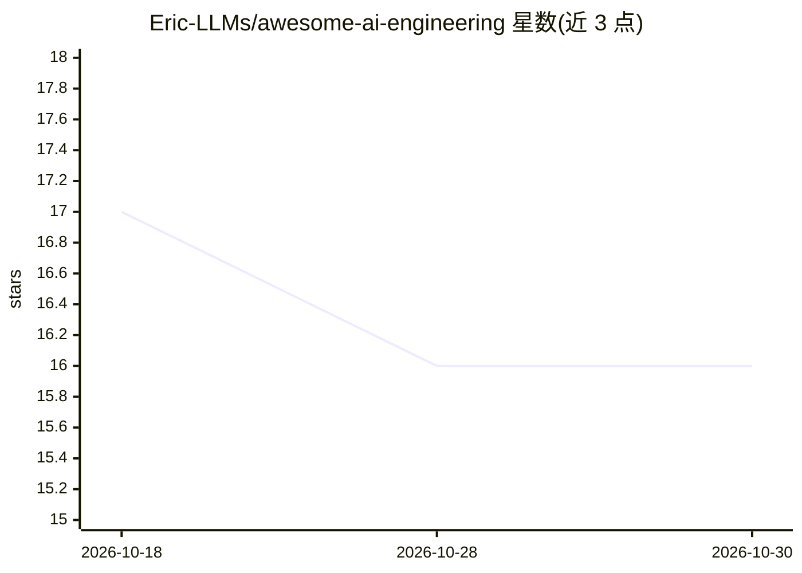

# Eric-LLMs/awesome-ai-engineering

⭐ 16 · NOASSERTION · 推送 2026-09-22 · [GitHub](https://github.com/Eric-LLMs/awesome-ai-engineering) · 个人维护 · 中文 README

**全栈 AI 工程知识手册：基础设施、训练、Agent、评测的指南与工具清单**

面向构建生产级 AI 系统与 agentic 应用的知识型 playbook：以端到端架构图和思维导图组织内容，覆盖 LLM 生产化、企业私有 AI 基础设施、Agent 构建、MCP、Agent 记忆与评测工程等主题；每章配套 PDF 幻灯片、可下载思维导图，以及精选开源项目清单（DeepSpeed、vLLM、Ollama、veRL、Bifrost 等分类列举）和动手实验模块（LLMs-Lab、Delveta 示例系统）。内容以阅读与查阅为主，不提供本仓库的安装运行方式。许可证为 CC BY 4.0。

## 筛选速览

| 维度 | 判定 | 备注 |
|---|---|---|
| AI 角色 | `ai-knowledge` | 知识聚合/清单类 |
| 许可风险 | `none` | NOASSERTION |
| 部署形态 | `None` |  |
| 模型依赖 | — | README 未给出锁定关系 |
| 硬件要求 | — | 无带数字的原话,不猜 |
| 安装摩擦 | `low` | 无编译、无系统依赖或容器化 |
| 成熟度 | — | 结构信号不足 |

## 能力要点

- 端到端 AI 工程架构图（离线模型开发与在线服务分离）
- 六大主题章节：LLM 生产化、私有基础设施、Agent、MCP、记忆、评测
- 各章配套思维导图与 PDF 幻灯片
- 分类收录基础设施、微调、RL 对齐、推理服务、网关、安全护栏等开源项目

## 适用场景

- 系统学习 AI 工程全栈知识（从基础设施到部署评测）
- 按类别查找训练、推理、Agent 相关的开源工具选型
- 查阅 Agent 记忆、MCP、评测工程等专题的入门材料

## 场景标签

`精选清单` `教程课程` · 领域:学习与行业

## 证据(README 行号)

> L7: A practical, systems-level guide to building production AI systems
> L16: A system-level view of AI engineering — from compute and data infrastructure, through model development, inference,
> L168: The following open-source projects represent prominent examples of agentic AI engineering:

## 星数曲线

2026-10-18 17 → 2026-10-30 16（-1）

---
*卡片 v1 · prompt 1.4 · 生成 2026-10-30 · 置信度 high · 依据 README sha `1cd1bcbcdcfe` · [字段定义](../../DATASET.md)*
