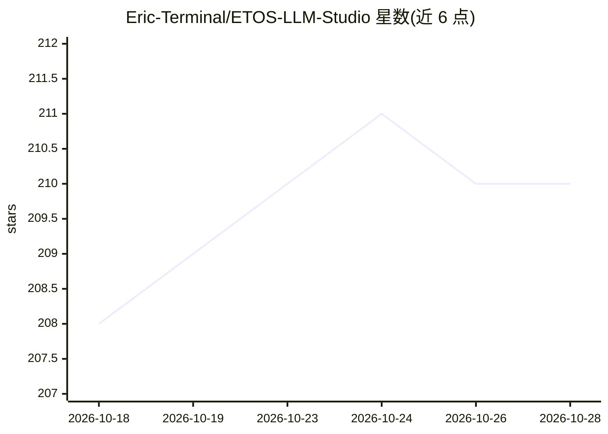

# Eric-Terminal/ETOS-LLM-Studio

⭐ 210 · Swift · GPL-3.0 · 推送 2026-10-24 · [GitHub](https://github.com/Eric-Terminal/ETOS-LLM-Studio) · 个人维护 · 中文 README

**iOS/Apple Watch 原生 LLM 客户端：云端模型+本地 GGUF 推理与 Agent 工具**

用 Swift/SwiftUI 编写的 iOS 与 watchOS 原生 AI/Agent 客户端：支持 OpenAI、Anthropic Claude、Google Gemini 接口，并可导入 GGUF 权重经 llama.cpp C ABI 在本机离线运行。Agent 模式提供 MCP 工具、64 项 Apple 原生能力工具、受控 WKWebView 浏览器、内置 Alpine Linux（iSH）执行命令与 Skill 脚本，另含本地 RAG 记忆（SQLite 向量库）、世界书、Siri 快捷指令与双端同步。以 GPLv3 开源，可自行用 Xcode 编译，App Store 版本收费。作者为个人开发者（学生），自述 iPhone 端仍有继续打磨的部分。

## 筛选速览

| 维度 | 判定 | 备注 |
|---|---|---|
| AI 角色 | `ai-native` | 本体是模型或模型工具 |
| 许可风险 | `viral` | GPL-3.0 |
| 部署形态 | `None` |  |
| 模型依赖 | local-ok | 支持本地模型 |
| 硬件要求 | — | 无带数字的原话,不猜 |
| 安装摩擦 | `medium` | 含编译或系统依赖之一 |
| 成熟度 | `idea` | |

## 能力要点

- 导入 GGUF 权重经 llama.cpp 桥接在 iOS/watchOS 本机推理，支持 LoRA Adapter 与采样参数调节
- MCP 工具、64 项 Apple 原生工具、Browser Agent 与内置 Alpine Linux（iSH）组成 Agent 运行环境
- 本地 RAG 记忆，向量数据库完全本地运行（SQLite/GRDB），可选 SQLCipher 全盘加密
- iOS ↔ watchOS 同步引擎，支持 CloudKit、iCloud Drive 与 S3/R2 云备份

## 适用场景

- 在 iPhone 和 Apple Watch 上离线运行本地 GGUF 模型聊天
- 通过 Agent 模式调用 MCP、原生能力与内置 Linux 完成任务
- 用本地 RAG 记忆与世界书管理长期上下文
- 云端多提供商（OpenAI/Claude/Gemini）统一客户端管理

## 场景标签

`AI 助手` `聊天机器人` `浏览器自动化` · 领域:效率与自动化

## 证据(README 行号)

> L8: **一个运行在 iOS 和 Apple Watch 上的原生 AI / Agent 客户端。支持 OpenAI、Anthropic Claude、Google Gemini 与本机 GGUF / llama.cpp 模型，并提供会话
> L35: * **端侧本地模型**：支持导入 GGUF 权重并作为“本地模型”提供商使用，底层通过 llama.cpp C ABI 桥接执行；支持流式输出、GGUF Jinja chat template、本地工具调用解析、思考内容解析、本
> L141: * **本地推理**: llama.cpp / GGUF, Swift ↔ C ABI ↔ C++ 桥接, CMake + Ninja 预编译 `libetos-llama.a`, Accelerate / Metal（watc

## 星数曲线

2026-10-18 208 → 2026-10-28 210（+2）

---
*卡片 v1 · prompt 1.4 · 生成 2026-10-22 · 置信度 high · 依据 README sha `34518c8963ec` · [字段定义](../../DATASET.md)*
