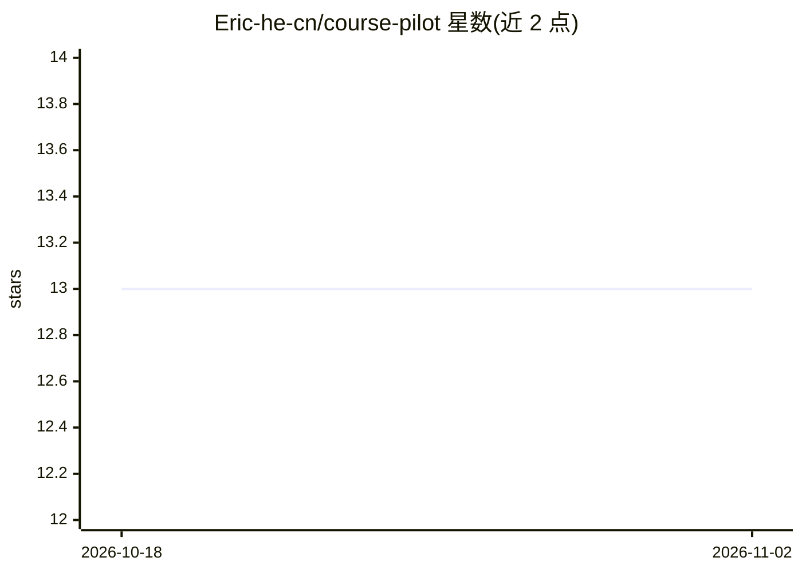

# Eric-he-cn/course-pilot

⭐ 13 · Python · MIT · 推送 2026-09-29 · [GitHub](https://github.com/Eric-he-cn/course-pilot) · 个人维护 · 中文 README

**面向大学生的本地课程学习 agent：上传教材获得可溯源的学习助手**

个人开源、本地运行的学习 agent 应用：上传教材后可进行带页码溯源的问答（语义向量+关键词混合检索）、模型自建知识页、练题与掌握度计算（BKT 与 FSRS 简化版）、学习计划、错题本与笔记。底层是一套 agent harness：22 个工具按副作用分六档、服务端兜底规程、六分区上下文预算、JSONL trace 与分层评测，支持 MCP Streamable HTTP 接入外部工具。接入任何说 OpenAI Chat Completions 或 Responses 协议的模型服务。掌握度参数未在真实答题数据上标定，绝对分数解读无依据；不做整卷模考，无部署链路。

## 筛选速览

| 维度 | 判定 | 备注 |
|---|---|---|
| AI 角色 | `ai-native` | 本体是模型或模型工具 |
| 许可风险 | `permissive` | MIT |
| 部署形态 | `library` | 以包/库形式分发 |
| 模型依赖 | — | README 未给出锁定关系 |
| 硬件要求 | — | 无带数字的原话,不猜 |
| 安装摩擦 | `low` | 无编译、无系统依赖或容器化 |
| 成熟度 | — | 结构信号不足 |

## 能力要点

- 每句结论标到教材文件名与页码，三类来源统一编号列出
- 掌握度由 BKT（四参数）与 FSRS 确定性算法计算，答题记录只增不改可重算
- 22 个工具按副作用分档，服务端校验补救规程缺失步骤
- 五个内置 Skill（练题/卡片/图示/错题复盘/研究），支持导入 SKILL.md

## 适用场景

- 上传教材自学课程，问答时核对每句结论的出处
- 练题并按概念沉淀掌握度，据此调整学习计划
- 复盘错题与薄弱概念，生成学习卡片与笔记
- 接入自有 MCP server 扩展 agent 工具

## 场景标签

`文档问答` · 领域:知识与检索

## 证据(README 行号)

> L14: **上传这门课的教材，得到一个记得你学到哪的学习 agent。** 每句结论都能落回教材页码，做过的题按概念沉淀成掌握度，计划按掌握度调整。
> L16: 它自己决定这一轮查什么、加载哪份规程、要不要写计划写笔记写记忆，信息不够时反问你；该做没做的步骤由服务端检出来补上。底下是一套完整的 agent harness，清单在这里。

## 星数曲线

2026-10-18 13 → 2026-11-02 13（+0）

---
*卡片 v1 · prompt 1.4 · 生成 2026-10-31 · 置信度 high · 依据 README sha `b50f02d853f2` · [字段定义](../../DATASET.md)*
