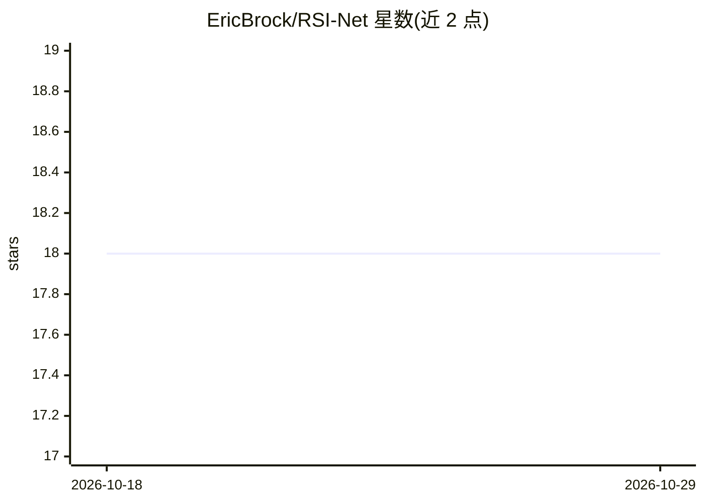

# EricBrock/RSI-Net

⭐ 18 · Python · 推送 2026-10-08 · [GitHub](https://github.com/EricBrock/RSI-Net) · 个人维护 · 中文 README

**遥感图像超分与着色的多任务卷积神经网络（TGRS 2022 官方代码）**

论文《A Deep Multi-task Convolutional Neural Network for Remote Sensing Image Super-resolution and Colorization》（IEEE TGRS 2022）的官方 PyTorch 实现。单一网络 RSI-Net 同时支持遥感图像超分辨率（X2/X4/X8）、着色、超分+着色联合任务，以及仅需输入 PAN 的 pan-sharpening。提供 prepare.py 准备 NWPU-45 训练数据、train.py 训练、test.py 测试，附预训练模型下载（百度网盘与 Google Drive），测试数据集为 AID 与 RSSCN7。需 Python 3.8 与 torch 1.10.0+cu113。

## 筛选速览

| 维度 | 判定 | 备注 |
|---|---|---|
| AI 角色 | `ai-native` | 本体是模型或模型工具 |
| 许可风险 | `none` | — |
| 部署形态 | `None` |  |
| 模型依赖 | — | README 未给出锁定关系 |
| 硬件要求 | — | 无带数字的原话,不猜 |
| 安装摩擦 | `medium` | 含编译或系统依赖之一 |
| 成熟度 | — | 结构信号不足 |

## 能力要点

- 单网络多任务：超分（X2/X4/X8）、着色与联合 SR+着色
- 仅输入 PAN 完成 pan-sharpening（无需 MS 图像）
- 提供预训练模型与训练/测试脚本

## 适用场景

- 对遥感图像做超分辨率或着色处理
- 用 PAN 图像直接做 pan-sharpening
- 复现 TGRS 2022 论文实验结果

## 场景标签

`图像视频处理` · 领域:感知与多模态

## 证据(README 行号)

> L2: Official Pytorch code of "A Deep Multi-task Convolutional Neural Network for Remote Sensing Image Super-resolution a
> L5: Remote sensing data have become increasingly vital in target detection, disaster monitoring, and military surveillan

## 星数曲线

2026-10-18 18 → 2026-10-29 18（+0）

---
*卡片 v1 · prompt 1.4 · 生成 2026-10-29 · 置信度 high · 依据 README sha `3571997ec519` · [字段定义](../../DATASET.md)*
