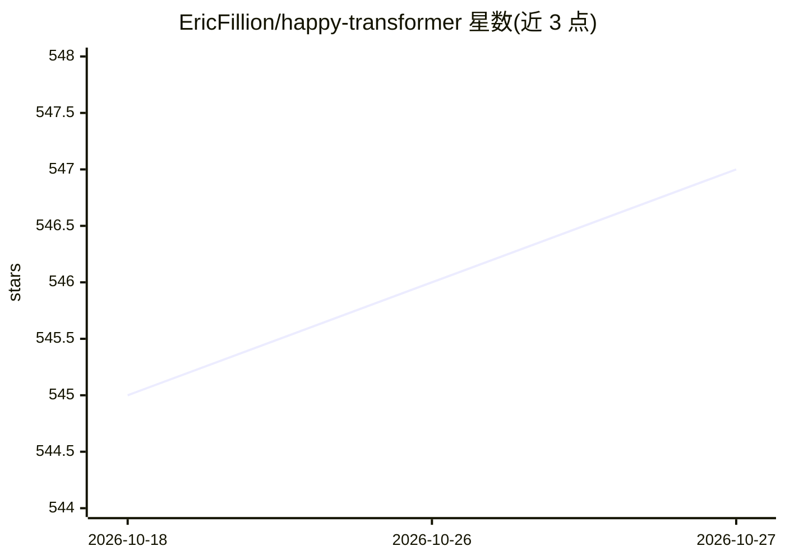

# EricFillion/happy-transformer

⭐ 547 · Python · Apache-2.0 · 推送 2026-01-10 · [GitHub](https://github.com/EricFillion/happy-transformer) · [官网](http://happytransformer.com) · 组织维护

**NLP Transformer 模型的微调与推理 Python 库**

Happy Transformer 是一个封装 Hugging Face 生态的 Python 库，提供文本生成、文本分类、问答、词预测等 NLP 任务的训练（微调）与推理接口。支持 GPT-Neo、T5、DistilBERT、RoBERTa 等模型的使用示例与教程。README 声明 4.0.0 版本为完全重写且含破坏性变更，建议在 requirements 中锁定 <4.0.0；同时注明词预测、问答、下句预测与 token 分类功能已被弃用。通过 pip 从 PyPI 安装，由个人维护者团队维护。

## 筛选速览

| 维度 | 判定 | 备注 |
|---|---|---|
| AI 角色 | `ai-native` | 本体是模型或模型工具 |
| 许可风险 | `permissive` | Apache-2.0 |
| 部署形态 | `library` | 以包/库形式分发 |
| 模型依赖 | — | README 未给出锁定关系 |
| 硬件要求 | — | 无带数字的原话,不猜 |
| 安装摩擦 | `low` | 无编译、无系统依赖或容器化 |
| 成熟度 | — | 结构信号不足 |

## 能力要点

- 覆盖文本生成、分类、问答等 7 类任务的训练/推理支持表格
- 支持 GPT-Neo、T5、DistilBERT、RoBERTa 等模型（教程示例）
- 4.0.0 完全重写版本处于开发最后阶段，含破坏性变更

## 适用场景

- 微调文本分类或语法纠错模型并用其推理
- 用 GPT-Neo 等模型做文本生成训练
- 以更简接口调用 Transformer 模型完成 NLP 任务

## 场景标签

`微调` `推理引擎` · 领域:训练与推理

## 证据(README 行号)

> L20: Happy Transformer makes it easy to fine-tune and perform inference with NLP Transformer models.
> L30: |Tasks|Inference|Training|

## 星数曲线

2026-10-18 545 → 2026-10-27 547（+2）

---
*卡片 v1 · prompt 1.4 · 生成 2026-10-21 · 置信度 high · 依据 README sha `e7b47ccd734b` · [字段定义](../../DATASET.md)*
