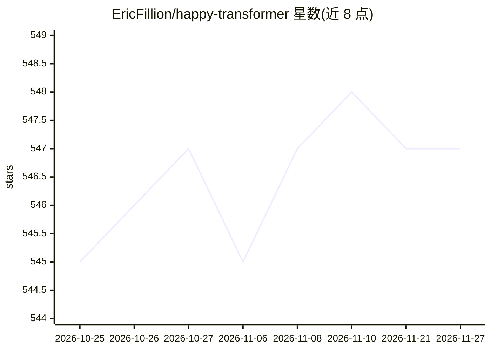

# EricFillion/happy-transformer

⭐ 547 · Python · Apache-2.0 · 推送 2026-11-26 · [GitHub](https://github.com/EricFillion/happy-transformer) · [官网](http://happytransformer.com) · 个人维护

**简化 NLP Transformer 微调与推理的 Python 库**

基于 PyTorch/Hugging Face 生态的 Python 库，封装 NLP Transformer 模型的微调与推理接口，覆盖文本生成、文本分类、词预测、问答、text-to-text 等任务，并提供教程文章与视频（含语法纠错、仇恨言论检测、情感分析示例）。注意：词预测、问答、下一句预测和 token 分类已被官方声明废弃；安装需固定在 4.0.0 以下版本。

## 筛选速览

| 维度 | 判定 | 备注 |
|---|---|---|
| AI 角色 | `ai-native` | 本体是模型或模型工具 |
| 许可风险 | `permissive` | Apache-2.0 |
| 部署形态 | `library` | 以包/库形式分发 |
| 模型依赖 | — | README 未给出锁定关系 |
| 硬件要求 | — | 无带数字的原话,不猜 |
| 安装摩擦 | `low` | 无编译、无系统依赖或容器化 |
| 成熟度 | — | 结构信号不足 |

## 能力要点

- 支持文本生成、文本分类、问答、text-to-text 等任务的训练与推理
- pip 安装、PyPI 发布，附带教程文章与视频
- 部分任务（词预测/问答/NSP/token 分类）已声明废弃

## 适用场景

- 微调 BERT/T5/GPT 类模型完成文本分类任务
- 对预训练语言模型做推理
- 按教程构建语法纠错或情感分析模型

## 场景标签

`微调` · 领域:训练与推理

## 证据(README 行号)

> L20: Happy Transformer makes it easy to fine-tune and perform inference with NLP Transformer models.
> L26: |Text Generation|✔|✔|
> L34: Note: word prediction, question answering, next sentence prediction and token classification have been deprecated.

## 星数曲线

2026-10-25 545 → 2026-11-27 547（+2）

---
*卡片 v1 · prompt 1.4 · 生成 2026-11-27 · 置信度 high · 依据 README sha `6c20a0509c97` · [字段定义](../../DATASET.md)*
