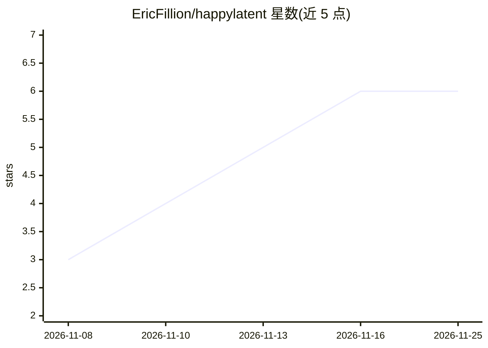

# EricFillion/happylatent

⭐ 6 · JavaScript · GPL-3.0 · 推送 2026-11-21 · [GitHub](https://github.com/EricFillion/happylatent) · 个人维护

**给 ComfyUI 用户的 LTX 2.5 视频时间线编辑器**

以 ComfyUI 自定义节点形式提供的可视化时间线编辑器，用于配合 LTX 2.5 模型生成视频：在时间线上排列场景并调整时长，每个场景可用提示词及可选的首尾帧图像引导，逐剪辑选择生成音频、上传音频或静音，并支持提升分辨率、提高帧率与输出精修。提供 ComfyUI Manager、comfy CLI 与手动 git clone 三种安装方式，需另行获取 LTX 2.5 模型、文本编码器、视频 VAE 与音频 VAE，附图生视频、多场景、首尾帧示例工作流。

## 筛选速览

| 维度 | 判定 | 备注 |
|---|---|---|
| AI 角色 | `ai-native` | 本体是模型或模型工具 |
| 许可风险 | `viral` | GPL-3.0 |
| 部署形态 | `None` |  |
| 模型依赖 | — | README 未给出锁定关系 |
| 硬件要求 | — | 无带数字的原话,不猜 |
| 安装摩擦 | `low` | 无编译、无系统依赖或容器化 |
| 成熟度 | — | 结构信号不足 |

## 能力要点

- 时间线上排列场景并调整时长，提示词与首尾帧图像引导
- 逐剪辑选择生成音频、上传音频或静音
- 支持提升分辨率、提高帧率与输出精修
- 附带图生视频、多场景、首尾帧示例工作流

## 适用场景

- 在 ComfyUI 中按时间线编排多场景视频生成
- 用首尾帧图像控制视频片段的起止画面
- 为生成的视频片段配置配音或静音

## 场景标签

`视频生成` · 领域:内容生成

## 证据(README 行号)

> L13: A visual editor for generating videos with LTX 2.5 in ComfyUI.
> L42: Restart ComfyUI, then add the HappyLatentVideo node to your workflow. Generation requires the LTX 2.5 model, text e

## 星数曲线

2026-11-08 3 → 2026-11-25 6（+3）

---
*卡片 v1 · prompt 1.4 · 生成 2026-11-20 · 置信度 high · 依据 README sha `e9a78921ed5c` · [字段定义](../../DATASET.md)*
