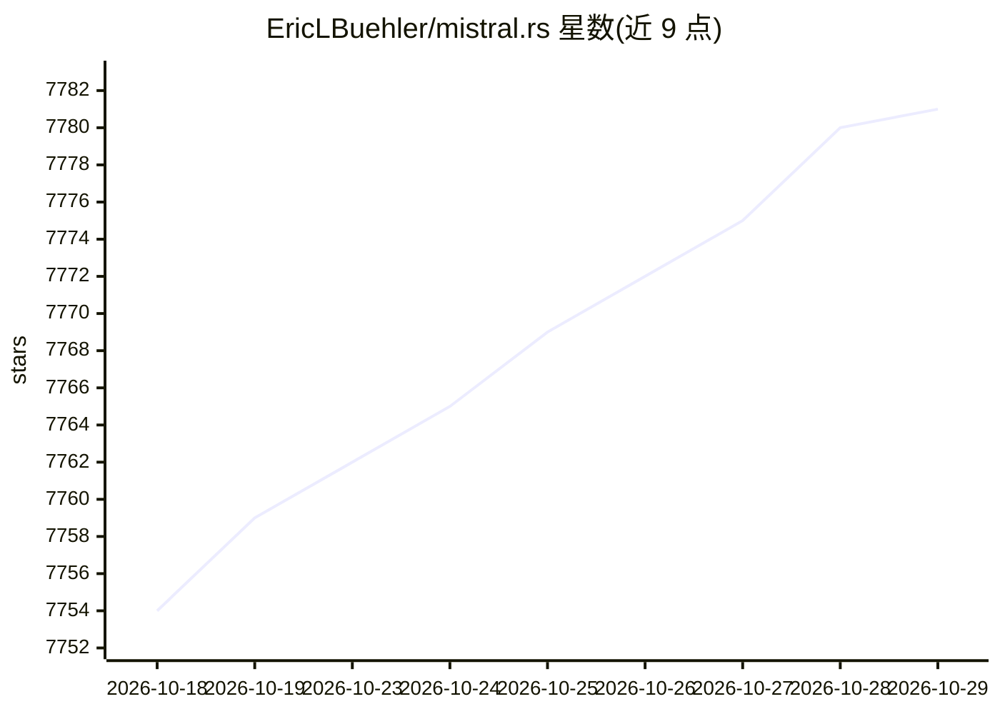

# EricLBuehler/mistral.rs

⭐ 7,781 · Rust · MIT · 推送 2026-10-28 · [GitHub](https://github.com/EricLBuehler/mistral.rs) · 个人维护

**Rust 编写的 LLM 推理引擎与服务器，面向开发者本地部署**

基于 Candle 的 LLM 推理引擎：单一二进制 CLI（run/serve/bench）与 Python/Rust SDK，支持 Hugging Face、GGUF、UQFF 格式加载，45+ 架构。提供 OpenAI 与 Anthropic 兼容的 HTTP 服务、内置 Web UI、Prometheus 指标。性能机制包括默认连续批处理、PagedAttention、前缀缓存、ISQ 量化及 GGUF/GPTQ/AWQ/FP8 等格式，支持 CUDA（FlashAttention V2/V3）、Metal 与多 GPU 分布式。内置 agent 循环：工具调用、Python/Shell 执行、MCP 客户端与 Web 搜索。安装脚本下载预编译二进制，Docker 镜像发布于 GHCR；与 Mistral AI 无关。

## 筛选速览

| 维度 | 判定 | 备注 |
|---|---|---|
| AI 角色 | `ai-ecosystem` | LLM/agent 周边工具 |
| 许可风险 | `permissive` | MIT |
| 部署形态 | `library` | 以包/库形式分发 |
| 模型依赖 | — | README 未给出锁定关系 |
| 硬件要求 | — | 无带数字的原话,不猜 |
| 安装摩擦 | `medium` | 含编译或系统依赖之一 |
| 成熟度 | — | 结构信号不足 |

## 能力要点

- 单一二进制覆盖聊天、服务器、基准测试与 Web UI
- OpenAI + Anthropic 双兼容端点与 Prometheus 指标
- PagedAttention、前缀缓存、多种量化格式（ISQ/GGUF/GPTQ/AWQ/FP8 等）
- 内置 agent 循环：工具调用、Python/Shell 会话、MCP 客户端、Web 搜索

## 适用场景

- 本地或服务器上部署 OpenAI/Anthropic 兼容的 LLM API 服务
- 在 Python 或 Rust 应用中嵌入进程内推理
- 利用 mistralrs tune 按硬件选择量化与设备映射方案

## 场景标签

`推理引擎` `模型量化` · 领域:训练与推理

## 证据(README 行号)

> L1: mistral.rs - Fast, flexible LLM inference.
> L77: - **OpenAI + Anthropic compatible serving**: The same `mistralrs serve` process exposes OpenAI-compatible `/v1` end
> L118: - **All-in-one**: Single binary for chat, server, benchmarks, and web UI (`run`, `serve`, `bench`)

## 星数曲线

2026-10-18 7,754 → 2026-10-29 7,781（+27）

---
*卡片 v1 · prompt 1.4 · 生成 2026-10-20 · 置信度 high · 依据 README sha `61e10aafd820` · [字段定义](../../DATASET.md)*
