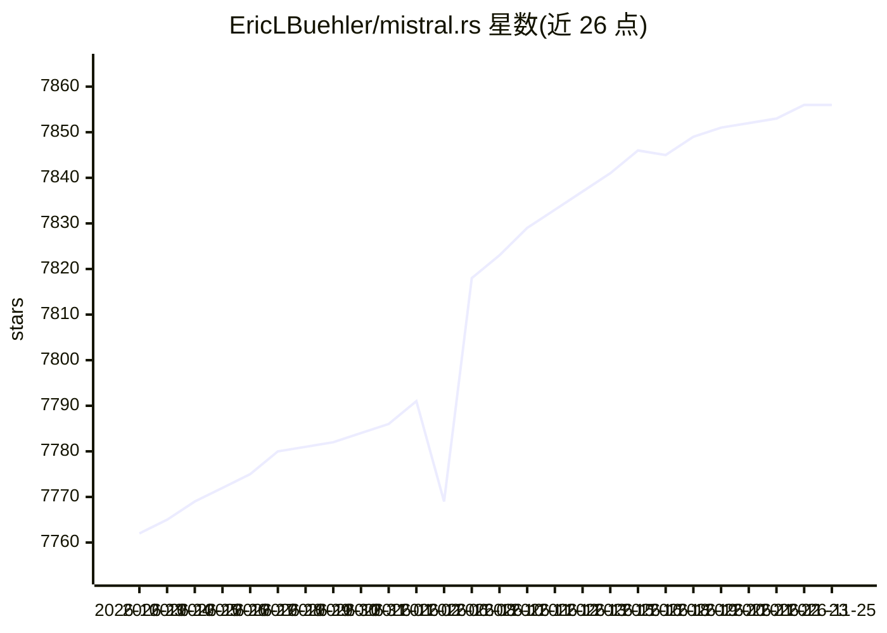

# EricLBuehler/mistral.rs

⭐ 7,856 · Rust · MIT · 推送 2026-11-20 · [GitHub](https://github.com/EricLBuehler/mistral.rs) · 个人维护

**Rust 编写的 LLM 推理引擎，提供 OpenAI/Anthropic 兼容服务**

用 Rust 实现的 LLM 推理引擎，支持文本、视觉、视频、音频、语音生成与嵌入等 45+ 模型架构。通过 `mistralrs serve` 提供 OpenAI 兼容 `/v1` 与 Anthropic Messages 端点，内置 Web UI、Prometheus 指标与 agentic 运行时（工具调用、Python/shell 执行、Web 搜索、MCP 客户端）。支持 ISQ、GGUF、GPTQ、AWQ 等量化与连续批处理、PagedAttention、多 GPU/分布式推理。提供 CLI 安装脚本、Python/Rust SDK 与 Docker 镜像，需自行处理模型资源。

## 筛选速览

| 维度 | 判定 | 备注 |
|---|---|---|
| AI 角色 | `ai-ecosystem` | LLM/agent 周边工具 |
| 许可风险 | `permissive` | MIT |
| 部署形态 | `library` | 以包/库形式分发 |
| 模型依赖 | locked-api |  |
| 硬件要求 | — | 无带数字的原话,不猜 |
| 安装摩擦 | `medium` | 含编译或系统依赖之一 |
| 成熟度 | — | 结构信号不足 |

## 能力要点

- OpenAI 兼容与 Anthropic Messages 兼容 HTTP 服务端点
- 文本/视觉/视频/音频/语音/嵌入多模态推理
- ISQ 在线量化与 GGUF/GPTQ/AWQ/HQQ/FP8/BNB 量化格式支持
- Python 与 Rust 双 SDK，进程内推理无需服务端

## 适用场景

- 本地起服务给 Claude Code/Codex 等编码 agent 供模型
- 用 Python SDK 在进程内加载模型做推理
- 在 CUDA/Metal 设备上量化并部署多模态模型

## 场景标签

`推理引擎` `模型量化` · 领域:训练与推理

## 证据(README 行号)

> L1: mistral.rs - Fast, flexible LLM inference.
> L78: - **Works with Claude Code and Codex**: The same `mistralrs serve` process exposes OpenAI-compatible `/v1` endpoint
> L82: - **Flexible SDKs**: Python package and Rust crate to build your projects.

## 星数曲线

2026-10-23 7,762 → 2026-11-25 7,856（+94）

---
*卡片 v1 · prompt 1.4 · 生成 2026-11-22 · 置信度 high · 依据 README sha `8ec99b404c72` · [字段定义](../../DATASET.md)*
