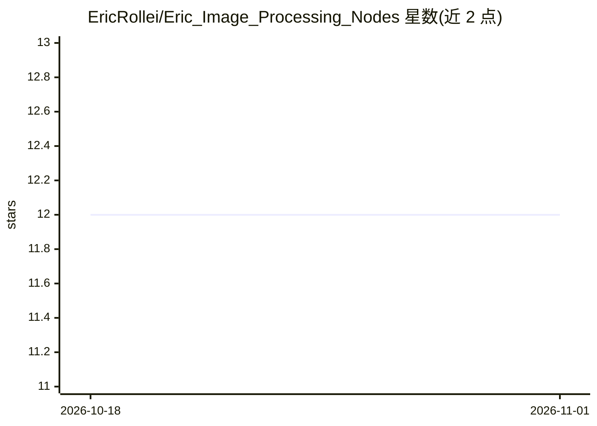

# EricRollei/Eric_Image_Processing_Nodes

⭐ 12 · Python · NOASSERTION · 推送 2025-12-20 · [GitHub](https://github.com/EricRollei/Eric_Image_Processing_Nodes) · [官网](https://historic.camera) · 个人维护

**面向 ComfyUI 的高级图像处理节点集，覆盖去噪/复原/增强**

ComfyUI 自定义节点集合，提供小波去噪、非局部均值、同态滤波、多尺度 FFT 增强、Richardson-Lucy 与 Wiener 复原等节点，并通过外部 DeepInv FastAPI 服务调用 DiffUNet、SwinIR、DRUNet 等预训练模型；另含胶片颗粒分析节点，区分真实胶片颗粒、数字噪声与合成叠加并按类型选择处理策略。GPU 加速依赖可选的 CuPy（CUDA），无 GPU 时自动回退 CPU。安装方式为克隆仓库至 custom_nodes 目录并安装 requirements，模型权重大多首次使用时自动下载（约 200MB 起）。

## 筛选速览

| 维度 | 判定 | 备注 |
|---|---|---|
| AI 角色 | `ai-native` | 本体是模型或模型工具 |
| 许可风险 | `none` | NOASSERTION |
| 部署形态 | `library` | 以包/库形式分发 |
| 模型依赖 | — | README 未给出锁定关系 |
| 硬件要求 | — | 无带数字的原话,不猜 |
| 安装摩擦 | `medium` | 含编译或系统依赖之一 |
| 成熟度 | — | 结构信号不足 |

## 能力要点

- 小波去噪（BayesShrink/VisuShrink/SureShrink，多小波族）与非局部均值去噪节点
- 外部 DeepInv 服务提供 DiffUNet/SwinIR/DRUNet 等预训练去噪模型
- 胶片颗粒类型自动分析与按类型的保留度控制（0-100%）
- CuPy CUDA 加速小波变换，自动 CPU 回退

## 适用场景

- 在 ComfyUI 工作流中对含噪图像做去噪或增强
- 修复离焦或运动模糊图像（Richardson-Lucy/Wiener 复原）
- 处理胶片扫描件时保留真实颗粒、去除数字噪声

## 场景标签

`图像视频处理` · 领域:感知与多模态

## 证据(README 行号)

> L94: - `DeepInv Denoise (Eric)` - DiffUNet, RAM, SwinIR, and classical denoisers served by the external DeepInv service
> L164: 1. Pick a preset (DiffUNet, RAM, SwinIR, DRUNet, DnCNN, SCUNet).
> L10: - **GPU Acceleration**: CUDA-accelerated wavelet transforms for high-performance processing

## 星数曲线

2026-10-18 12 → 2026-11-01 12（+0）

---
*卡片 v1 · prompt 1.4 · 生成 2026-11-01 · 置信度 low · 依据 README sha `b59c6d455bdd` · [字段定义](../../DATASET.md)*
