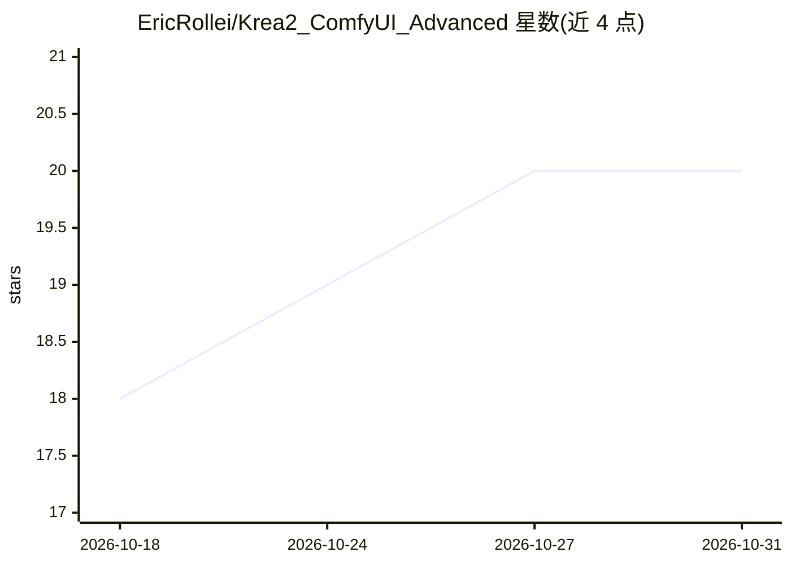

# EricRollei/Krea2_ComfyUI_Advanced

⭐ 20 · Python · NOASSERTION · 推送 2026-10-08 · [GitHub](https://github.com/EricRollei/Krea2_ComfyUI_Advanced) · 个人维护

**在 ComfyUI 中运行 Krea 2 图像模型的 diffusers 自定义节点包**

面向 ComfyUI 用户的自定义节点集合，通过 Hugging Face 官方 Krea2Pipeline（single-stream MMDiT、flow matching、Qwen3-VL 条件）驱动 Krea 2 文生图与图生图。提供多阶段渐进式高分辨率生成（最多 3 阶段、每阶段独立采样器/调度/引导）、2× 上采样解码、img2img、Control-LoRA 控制、免训练风格迁移、inpaint/outpaint、指令编辑、参考图语义锚定（Vision Prompt）、多 LoRA 堆栈与 JSON 预设系统。可选原生量化计算（INT8/MXFP8/NVFP4）。硬性依赖为包含 Krea2Pipeline 的 diffusers 版本与 Krea 2 权重，不依赖其他节点包。

## 筛选速览

| 维度 | 判定 | 备注 |
|---|---|---|
| AI 角色 | `ai-native` | 本体是模型或模型工具 |
| 许可风险 | `none` | NOASSERTION |
| 部署形态 | `desktop` | 安装包/桌面程序 |
| 模型依赖 | — | README 未给出锁定关系 |
| 硬件要求 | `gpu-24g` | |
| 安装摩擦 | `medium` | 含编译或系统依赖之一 |
| 成熟度 | — | 结构信号不足 |

## 能力要点

- 直接运行 Hugging Face 官方 Krea2Pipeline，最多 3 阶段渐进式高分辨率生成
- 图生图套件：Control-LoRA、免训练风格迁移、AnyPaint inpaint/outpaint、Identity Edit
- 基于 Qwen3-VL 视觉路径的 1-3 张参考图语义锚定（Vision Prompt）
- 可选 INT8-ConvRot/MXFP4/NVFP4 原生量化张量核计算（bf16 仍为默认）

## 适用场景

- 在 ComfyUI 里用 Raw/Turbo 两种 Krea 2 检查点做文生图与多阶段高分辨率出图
- 通过参考图做风格/内容锚定或编辑指令改图
- 用同一多阶段引擎完成控制生成、inpaint/outpaint 与风格迁移

## 场景标签

`图像生成` · 领域:内容生成

## 证据(README 行号)

> L3: Self-contained ComfyUI custom nodes for **Krea 2** - Krea AI's open-weight,
> L14: - **Real diffusers pipeline, not a reimplementation.** Runs the genuine Hugging
> L118: |**Eric Krea2 Loader**|Loads `Krea2Pipeline` (Raw or Turbo), applies `attention_backend`, caches in VRAM. Auto-det

## 星数曲线

2026-10-18 18 → 2026-10-31 20（+2）

---
*卡片 v1 · prompt 1.4 · 生成 2026-10-28 · 置信度 mid · 依据 README sha `baeb141588e0` · [字段定义](../../DATASET.md)*
