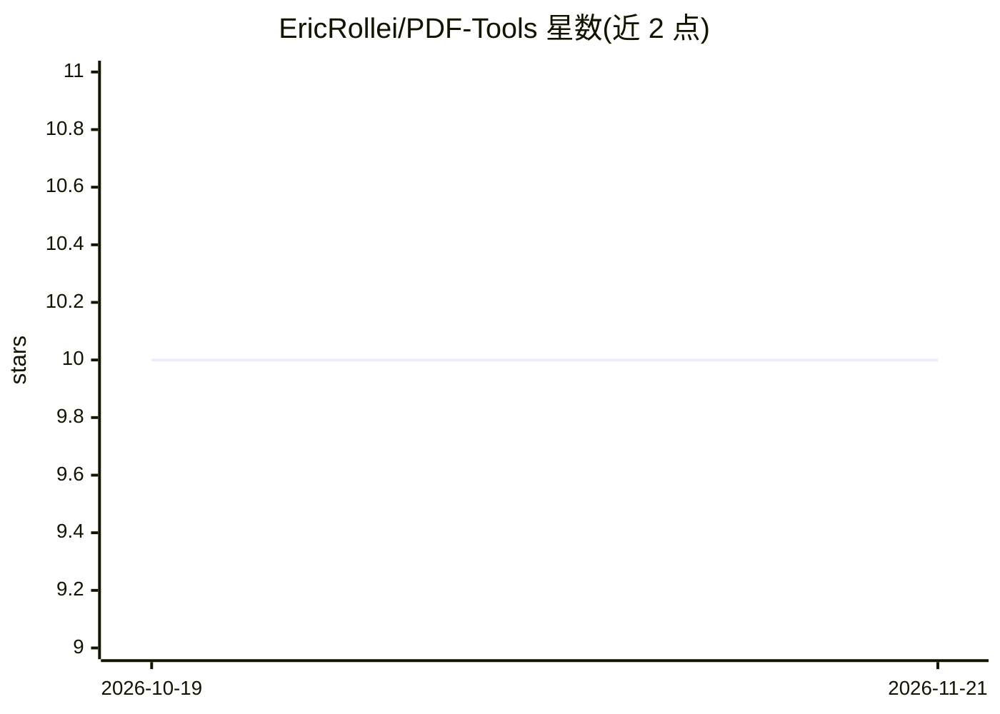

# EricRollei/PDF-Tools

⭐ 10 · Python · NOASSERTION · 推送 2025-12-20 · [GitHub](https://github.com/EricRollei/PDF-Tools) · [官网](https://historic.camera) · 个人维护

**ComfyUI 节点包：PDF 图像提取、多语言 OCR 与文档版面分析**

面向 ComfyUI 的自定义节点集合，按 PDF 提取、OCR、版面分析、AI 视觉四类提供节点：PDF 图像提取带质量评分、跨页检测与去重；Surya OCR 支持 90+ 语言；PaddleOCR VL 面向中文/中日韩文档，需独立虚拟环境以避开 CUDA 版本冲突；LayoutLMv3 与 Enhanced Layout Parser 输出文档结构；Florence-2 节点做目标检测、裁剪与图像描述。Windows 为主，通过 install.ps1 安装，依赖 PyMuPDF、torch、transformers 等自动安装。

## 筛选速览

| 维度 | 判定 | 备注 |
|---|---|---|
| AI 角色 | `ai-native` | 本体是模型或模型工具 |
| 许可风险 | `none` | NOASSERTION |
| 部署形态 | `None` |  |
| 模型依赖 | — | README 未给出锁定关系 |
| 硬件要求 | — | 无带数字的原话,不猜 |
| 安装摩擦 | `medium` | 含编译或系统依赖之一 |
| 成熟度 | — | 结构信号不足 |

## 能力要点

- PDF 图像提取：质量评分、跨页检测、去重、JSON 元数据导出
- Surya OCR 支持 90+ 语言的版面感知文本提取
- PaddleOCR VL 节点面向中文/中日韩文档，以独立服务运行
- Florence-2 节点提供目标检测、区域裁剪、图像描述与视觉问答

## 适用场景

- 从扫描书籍 PDF 批量提取高质量图片
- 对多语言扫描文档做 OCR 并保留阅读顺序
- 识别文档中的标题、表格、段落等版面结构
- 在 ComfyUI 工作流中对图片做目标检测与裁剪

## 场景标签

`文档解析` `OCR` `目标检测` · 领域:知识与检索

## 证据(README 行号)

> L3: Advanced PDF processing, OCR, and AI vision analysis nodes for ComfyUI.
> L53: - **Surya OCR Layout Node** - State-of-the-art multilingual OCR
> L83: - **Florence2 Rectangle Detector** - Microsoft Florence-2 vision model

## 星数曲线

2026-10-19 10 → 2026-11-21 10（+0）

---
*卡片 v1 · prompt 1.4 · 生成 2026-11-20 · 置信度 high · 依据 README sha `0fbf24dabff2` · [字段定义](../../DATASET.md)*
