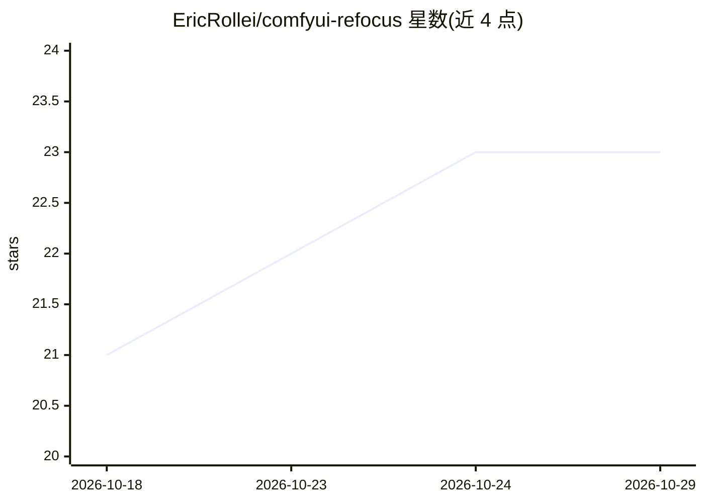

# EricRollei/comfyui-refocus

⭐ 23 · Python · Apache-2.0 · 推送 2026-05-04 · [GitHub](https://github.com/EricRollei/comfyui-refocus) · [官网](http://historic.camera) · 个人维护

**ComfyUI 节点集：生成式重新对焦、去模糊与景深估计**

ComfyUI 自定义节点集，封装 Genfocus 生成式重对焦管线：DeblurNet 从模糊输入恢复全焦图像，BokehNet 生成可控景深虚化效果，集成 Apple ml-depth-pro 做度量深度估计并提供深度格式转换工具。模型加载支持两种方式：完整 diffusers FLUX.1-dev 文件夹（约 23GB），或由 Civitai 单文件 checkpoint 与标准编码器/VAE 组装（组件加载器，首次运行自动下载约 5MB 配置）。Genfocus LoRA 基于 FLUX.1-dev 训练，不支持 FLUX.1-schnell。通过 git clone 安装到 custom_nodes，需 pip 安装 diffusers 等依赖。

## 筛选速览

| 维度 | 判定 | 备注 |
|---|---|---|
| AI 角色 | `ai-native` | 本体是模型或模型工具 |
| 许可风险 | `permissive` | Apache-2.0 |
| 部署形态 | `library` | 以包/库形式分发 |
| 模型依赖 | — | README 未给出锁定关系 |
| 硬件要求 | — | 无带数字的原话,不猜 |
| 安装摩擦 | `medium` | 含编译或系统依赖之一 |
| 成熟度 | — | 结构信号不足 |

## 能力要点

- DeblurNet 全焦恢复与 BokehNet 可控景深生成
- 基于 Apple ml-depth-pro 的度量深度估计与焦距估计
- 组件加载器免 23GB diffusers 下载，复用现有 FLUX checkpoint
- 提供去模糊、重对焦等即用工作流 JSON 文件

## 适用场景

- 在 ComfyUI 中对模糊照片做全焦恢复
- 为照片添加可控的散景/景深虚化效果
- 生成深度图与视差图用于图像编辑流程

## 场景标签

`图像生成` `图像视频处理` · 领域:内容生成

## 证据(README 行号)

> L11: ComfyUI custom nodes for the Genfocus generative refocusing pipeline.
> L17: - **DeblurNet**: Restore all-in-focus images from blurry/defocused inputs
> L19: - **DepthPro**: High-quality metric depth estimation (Apple ml-depth-pro)

## 星数曲线

2026-10-18 21 → 2026-10-29 23（+2）

---
*卡片 v1 · prompt 1.4 · 生成 2026-10-27 · 置信度 mid · 依据 README sha `67c9222a04c4` · [字段定义](../../DATASET.md)*
