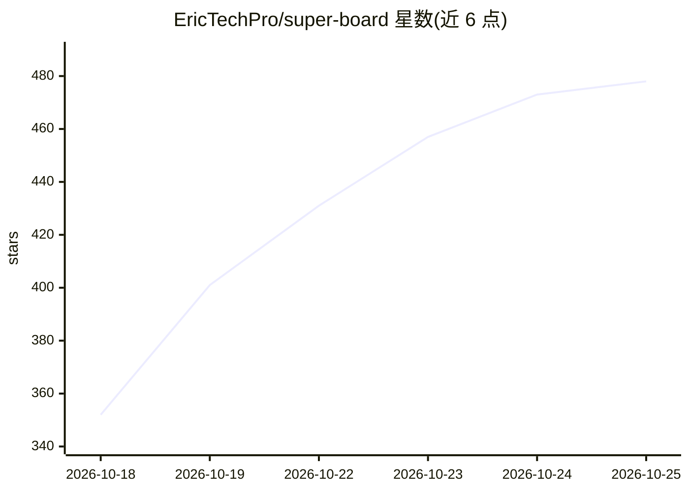

# EricTechPro/super-board

⭐ 478 · HTML · MIT · 推送 2026-10-23 · [GitHub](https://github.com/EricTechPro/super-board) · [官网](https://erictechpro.github.io/super-board/) · 个人维护

**Claude Code 的自主看板流水线：任务卡自动构建→QA→审查→合并 PR**

面向 Claude Code（也支持 Codex/OpenCode）的技能包与插件：把 GitHub Projects 看板变成自动化流水线，卡片经 Build（worktree+最小改动+测试+draft PR）、QA（证据/截图/测试缺口检查）、Review（合并门禁）三条泳道处理，通过后自动合并。含 8 个技能、9 个命令、6 个 Python 标准库实现的守卫钩子（拦截误删、密钥读写、危险 push 等）。模型路由按卡片难度分配 Haiku/Sonnet/Opus 或 Codex GPT 系列。需 Claude Code、gh、jq、bash 3.2+、Python 3.9+。

## 筛选速览

| 维度 | 判定 | 备注 |
|---|---|---|
| AI 角色 | `ai-ecosystem` | LLM/agent 周边工具 |
| 许可风险 | `permissive` | MIT |
| 部署形态 | `None` |  |
| 模型依赖 | — | README 未给出锁定关系 |
| 硬件要求 | — | 无带数字的原话,不猜 |
| 安装摩擦 | `low` | 无编译、无系统依赖或容器化 |
| 成熟度 | — | 结构信号不足 |

## 能力要点

- 看板卡片驱动的 Build→QA→Review 自动流水线，绿灯后自动合并 PR
- 6 个守卫钩子：worktree 路径、密钥读取、API key 字面量、越界删除、保护分支 push、merge 门禁
- 按卡片难度分级的模型路由，支持 Claude 与 Codex GPT 两套模型梯队
- 一行 curl 安装或 Claude Code 插件市场安装

## 适用场景

- 把想法写成看板任务卡，让流水线自动产出带验证的合并 PR
- 在 Claude Code 或 Codex 中以统一写作规范管理提交、工单与 PR
- 为代理编码过程加上密钥与危险操作的守卫护栏

## 场景标签

`编码 Agent` `工作流自动化` · 领域:效率与自动化

## 证据(README 行号)

> L82: |`/super-board`|Orchestrator: plans waves, runs Build → QA → Review, merges when green.|
> L92: |`/super-build`|Builder lane: worktree, smallest safe change, tests, draft PR.|
> L126: A cheap router grades each card easy, medium or hard first; the run flag picks the model for each grade. With `--c

## 星数曲线

2026-10-18 352 → 2026-10-25 478（+126）

---
*卡片 v1 · prompt 1.4 · 生成 2026-10-21 · 置信度 high · 依据 README sha `74f86f23556f` · [字段定义](../../DATASET.md)*
