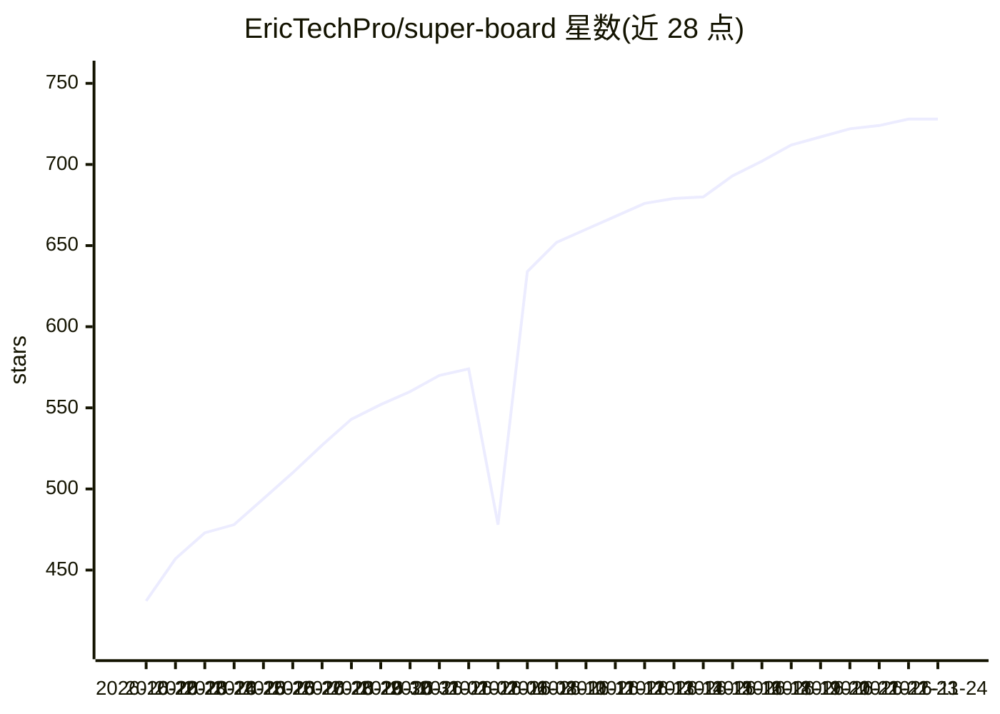

# EricTechPro/super-board

⭐ 728 · HTML · MIT · 推送 2026-10-29 · [GitHub](https://github.com/EricTechPro/super-board) · [官网](https://erictechpro.github.io/super-board/) · 个人维护

**给 Claude Code 加看板：任务卡片自动走构建→QA→评审循环**

为 Claude Code 主机提供的技能包/插件：用户往 Ready 列放入任务卡片，看板自动执行 Build→QA→Review 流水线，通过合并门（基于 verify_commands）后产出已测试、已评审的 PR。包含 9 个技能（5 个用户输入、4 个看板自动运行）、9 个命令和 6 个守卫 hook（worktree 路径、密钥、危险删除、受保护分支推送等）。路由器按卡片难度分级选模型，支持 --codex 切换到 Codex 模型阶梯；也可在 Codex/OpenCode 主机运行。安装后需完成 8 步 onboard 配置。

## 筛选速览

| 维度 | 判定 | 备注 |
|---|---|---|
| AI 角色 | `ai-ecosystem` | LLM/agent 周边工具 |
| 许可风险 | `permissive` | MIT |
| 部署形态 | `library` | 以包/库形式分发 |
| 模型依赖 | — | README 未给出锁定关系 |
| 硬件要求 | — | 无带数字的原话,不猜 |
| 安装摩擦 | `low` | 无编译、无系统依赖或容器化 |
| 成熟度 | — | 结构信号不足 |

## 能力要点

- Ready 列卡片自动执行 Build→QA→Review 并在通过合并门后合并
- 6 个守卫 hook：拦截密钥读取、API key 写入、越界删除与强推
- 按 easy/medium/hard 分级的模型路由，--codex 切换 Codex 模型阶梯
- 每个 PR diff 自动运行 pr-security-review 安全检查

## 适用场景

- 让多个编码任务卡片在无人值守下自动走完构建、测试、评审到合并
- 为 Claude Code 工作流加上安全守卫与合并门控
- 用 git worktree 并行处理多个看板任务

## 场景标签

`编码 Agent` `工作流自动化` · 领域:效率与自动化

## 证据(README 行号)

> L7:  Stop babysitting coding agents: cards you drop in Ready come back as tested, reviewed PRs.
> L106: |`/super-board`|Orchestrator: plans waves, runs Build → QA → Review, merges when green.|
> L151: A cheap router grades each card easy, medium or hard first; the run flag picks the model for each grade. With `--c

## 星数曲线

2026-10-22 431 → 2026-11-24 728（+297）

---
*卡片 v1 · prompt 1.4 · 生成 2026-11-24 · 置信度 mid · 依据 README sha `1f9c4f86f383` · [字段定义](../../DATASET.md)*
