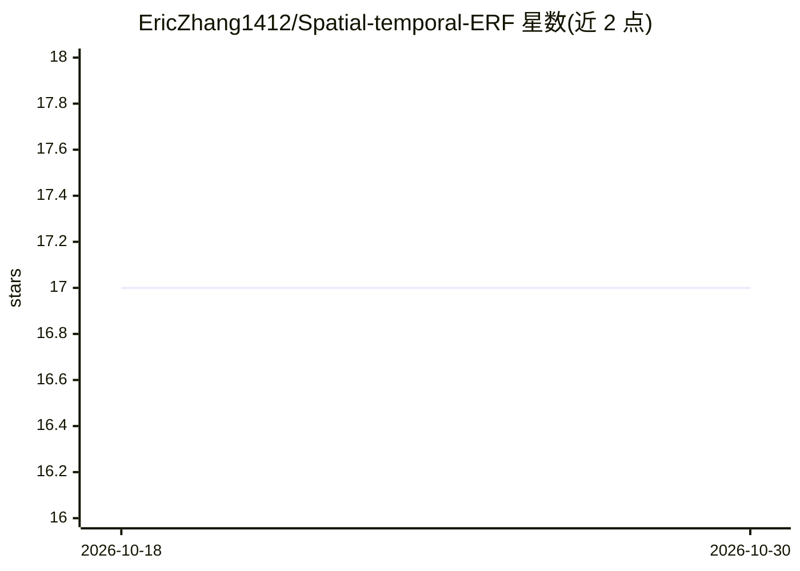

# EricZhang1412/Spatial-temporal-ERF

⭐ 17 · Python · 推送 2026-07-30 · [GitHub](https://github.com/EricZhang1412/Spatial-temporal-ERF) · 组织维护

**NeurIPS 2025 论文官方实现：SNN 时空有效感受野分析与实验代码**

提供 NeurIPS 2025 论文《Unveiling the Spatial-temporal Effective Receptive Fields of Spiking Neural Networks》的官方代码实现：erf_compute 目录用于计算时空有效感受野（含 izhikevich.py 等脚本），det 与 seg 目录分别承载基于 mmdetection/mmsegmentation 的检测与分割实验。环境要求 PyTorch（LTS 或 2.6.0+），额外可视化与 checkpoint 托管在 Hugging Face 仓库。作者团队联系邮箱为电子科技大学（UESTC）域名。

## 筛选速览

| 维度 | 判定 | 备注 |
|---|---|---|
| AI 角色 | `ai-native` | 本体是模型或模型工具 |
| 许可风险 | `none` | — |
| 部署形态 | `None` |  |
| 模型依赖 | — | README 未给出锁定关系 |
| 硬件要求 | — | 无带数字的原话,不猜 |
| 安装摩擦 | `low` | 无编译、无系统依赖或容器化 |
| 成熟度 | — | 结构信号不足 |

## 能力要点

- ST-ERF 计算主目录 erf_compute
- 检测实验基于 mmdetection，分割实验基于 mmsegmentation
- Hugging Face 提供更多可视化与 checkpoint

## 适用场景

- 复现论文中的时空有效感受野分析
- 在检测/分割任务上验证 SNN 感受野结论
- 获取论文配套的可视化与模型权重

## 场景标签

 · 领域:机器学习研究/SNN

## 证据(README 行号)

> L6: This repository provides the official implementation of the paper **"Unveiling the Spatial-temporal Effective Recept
> L16: ├── erf_compute # Main folder for ST-ERF

## 星数曲线

2026-10-18 17 → 2026-10-30 17（+0）

---
*卡片 v1 · prompt 1.4 · 生成 2026-10-30 · 置信度 high · 依据 README sha `5eb826dd1789` · [字段定义](../../DATASET.md)*
