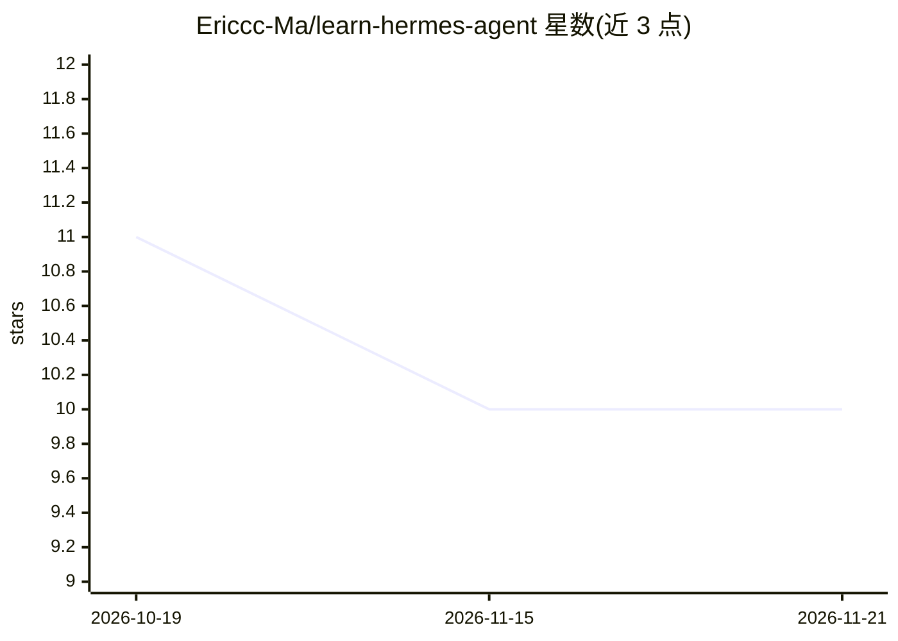

# Ericcc-Ma/learn-hermes-agent

⭐ 10 · Python · MIT · 推送 2026-06-08 · [GitHub](https://github.com/Ericcc-Ma/learn-hermes-agent) · 个人维护 · 中文 README

**从零复刻自进化 Agent Harness 的 24 课中文教程**

以递进课程形式教授 Hermes Agent 自进化系统的教学仓库：从 agent loop 加记忆文件起步，逐课叠加背景记忆/技能审查、技能生命周期与 Curator 整理、FTS5 记忆系统、上下文压缩、Insights 统计、gateway、定时任务、多 profile、子 agent、MCP、权限与 hook 等机制。每章为独立文件夹，含叙事文档与可运行 Python 代码，另提供源码地图指向生产源码。通过 llm.py 统一适配多家模型 provider，需设置 API key 运行。

## 筛选速览

| 维度 | 判定 | 备注 |
|---|---|---|
| AI 角色 | `ai-knowledge` | 知识聚合/清单类 |
| 许可风险 | `permissive` | MIT |
| 部署形态 | `library` | 以包/库形式分发 |
| 模型依赖 | local-ok | 支持本地模型 |
| 硬件要求 | — | 无带数字的原话,不猜 |
| 安装摩擦 | `low` | 无编译、无系统依赖或容器化 |
| 成熟度 | — | 结构信号不足 |

## 能力要点

- 24 章递进课程，每章一机制、附可运行代码与架构图
- 六层自进化架构：背景审查、技能生命周期、Curator、记忆、上下文管理、Insights
- llm.py 统一适配 Anthropic/DeepSeek/OpenAI/Qwen/GLM/Moonshot/Ollama 等接口
- 提供与生产源码对应的源码地图与 FAQ

## 适用场景

- 系统学习如何为 agent 构建记忆与技能沉淀机制
- 按源码地图从教学代码过渡到阅读 Hermes 生产源码
- 复用课程代码搭建带 Curator 与记忆管理的 agent 原型

## 场景标签

`教程课程` · 领域:学习与行业

## 证据(README 行号)

> L74: ## 24 个递进课程
> L78: > **s01** &nbsp; *"一个循环 + 一个记忆文件 = 最简单的学习 agent"* — 在 agent loop 上加 MEMORY.md，记住用户偏好
> L198: 按顺序从 s01 读到 s24。每章假定你已读过前面章节，章末有通往下一章的钩子。每个 README 末尾有 ` ` 折叠区引用 Hermes 生产源码。

## 星数曲线

2026-10-19 11 → 2026-11-21 10（-1）

---
*卡片 v1 · prompt 1.4 · 生成 2026-11-20 · 置信度 high · 依据 README sha `b5193fd4ecb3` · [字段定义](../../DATASET.md)*
