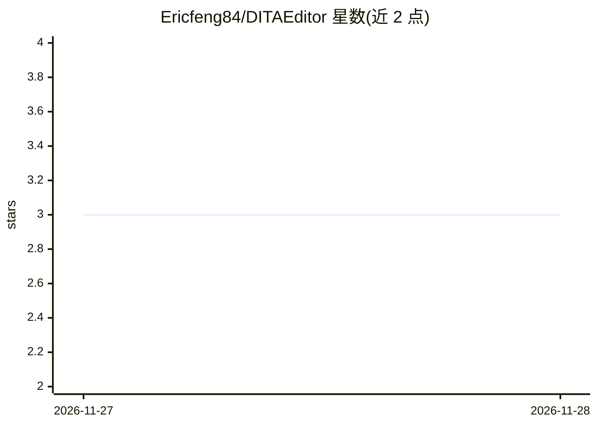

# Ericfeng84/DITAEditor

⭐ 3 · TypeScript · MIT · 推送 2026-11-27 · [GitHub](https://github.com/Ericfeng84/DITAEditor) · [官网](https://ericfeng84.github.io/DITAEditor/) · 个人维护 · 中文 README

**面向技术文档团队的 Web DITA 1.3 结构化写作工作台**

以标准 DITA XML 为唯一事实源的 Web 结构化写作工具：ProseMirror 可视化编辑与 CodeMirror XML 源码双模编辑，支持 Keyspace 键管理、Conref、DITAVAL 单一信息源语义，本地 Git 检出锁与可视化 Diff，DITA-OT 4.x 严格校验并发布带主题的 HTML5 与嵌入 Noto CJK 的中文 PDF。AI 部分提供片段级辅助写作与错误修复，AI 输出必须经 Diff 差异确认与检出锁守卫才能写入。通过 Docker 单容器交付，提供 macOS/Windows 安装包与浏览器离线版。

## 筛选速览

| 维度 | 判定 | 备注 |
|---|---|---|
| AI 角色 | `ai-enhanced` | 去掉 AI 部分产品仍成立 |
| 许可风险 | `permissive` | MIT |
| 部署形态 | `desktop` | 安装包/桌面程序 |
| 模型依赖 | locked-api |  |
| 硬件要求 | — | 无带数字的原话,不猜 |
| 安装摩擦 | `low` | 无编译、无系统依赖或容器化 |
| 成熟度 | — | 结构信号不足 |

## 能力要点

- ProseMirror 可视化与 CodeMirror XML 源码双模编辑，100% 无损往返
- Keyspace/Conref/DITAVAL 单一信息源语义引擎与可视化 Map/Bookmap 编排
- 本地 Git 版本管理、检出独占锁、干净基线+个人草稿叠加层
- LangChain.js 封装 OpenAI 兼容接口（默认 DeepSeek）的片段级 AI 辅助与修复

## 适用场景

- 技术文档团队协作编写与管理 DITA 1.3 手册
- 通过 keyspace/conref/DITAVAL 实现单一信息源内容复用与条件过滤
- 发布带主题的 HTML5 与中文 PDF 文档
- 用 AI 辅助重写/扩写片段或修复 XML 结构与校验错误

## 场景标签

`AI 写作` · 领域:内容生成

## 证据(README 行号)

> L11: 面向技术文档团队的 **Web DITA 1.3 结构化写作工作台**：ProseMirror 可视化编辑与 CodeMirror 6 XML 源码双模，可折叠**文档大纲视图**与受 DITA 1.3 内容模型约束的拖拽重排，可
> L164: ### 9. AI 辅助写作与错误修复（Phase 6）
> L173: - **模型与审计**：`@dita/api` 用 LangChain.js（`@langchain/core` + `@langchain/openai`）封装 OpenAI 兼容 `ChatOpenAI`，默认 DeepSe

## 星数曲线

2026-11-27 3 → 2026-11-28 3（+0）

---
*卡片 v1 · prompt 1.4 · 生成 2026-11-27 · 置信度 mid · 依据 README sha `d995fff9b79d` · [字段定义](../../DATASET.md)*
