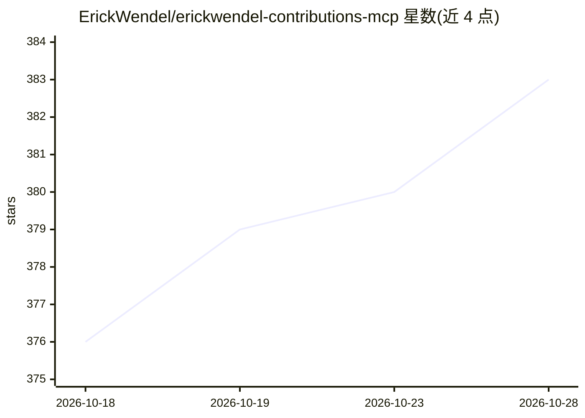

# ErickWendel/erickwendel-contributions-mcp

⭐ 383 · TypeScript · MIT · 推送 2026-01-08 · [GitHub](https://github.com/ErickWendel/erickwendel-contributions-mcp) · [官网](https://www.npmjs.com/package/@erickwendel/contributions-mcp) · 个人维护

**查询 Erick Wendel 内容产出的 MCP 服务器，供 AI 客户端调用**

一个 Model Context Protocol (MCP) 服务器，将 Erick Wendel 的演讲、博客文章与视频数据以工具形式暴露给 Claude Desktop、Cursor 等 MCP 客户端，用户可用自然语言查询内容统计与筛选。实现完整的 Tools/Prompts/Resources 三类 MCP 能力，提供 get-talks、get-posts、get-videos、check-status 四个工具，底层用 TypeScript 与 Zod 构建、GenQL 生成 SDK。可直接经 npx 配置免安装使用，或克隆仓库本地运行，要求 Node.js v23+，并支持经 MCPHost 搭配 Ollama 作为免费替代客户端。

## 筛选速览

| 维度 | 判定 | 备注 |
|---|---|---|
| AI 角色 | `ai-ecosystem` | LLM/agent 周边工具 |
| 许可风险 | `permissive` | MIT |
| 部署形态 | `library` | 以包/库形式分发 |
| 模型依赖 | local-ok | 支持本地模型 |
| 硬件要求 | — | 无带数字的原话,不猜 |
| 安装摩擦 | `low` | 无编译、无系统依赖或容器化 |
| 成熟度 | — | 结构信号不足 |

## 能力要点

- 提供 get-talks / get-posts / get-videos / check-status 四个查询工具
- 完整实现 MCP 的 Tools、Prompts、Resources 三类能力
- TypeScript + Zod 类型校验，GenQL 生成 SDK
- 可通过 MCPHost 搭配 Ollama 免费使用

## 适用场景

- 在 Claude Desktop 或 Cursor 中用自然语言查询演讲、文章、视频
- 统计某年份或某语言的内容产出情况
- 无 Claude/Cursor 订阅时用 MCPHost + Ollama 接入

## 场景标签

 · 领域:开发者工具/MCP 服务器

## 证据(README 行号)

> L7: A Model Context Protocol (MCP) server that provides tools to query Erick Wendel's contributions across different pla
> L182: - Built with Model Context Protocol (MCP)

## 星数曲线

2026-10-18 376 → 2026-10-28 383（+7）

---
*卡片 v1 · prompt 1.4 · 生成 2026-10-22 · 置信度 high · 依据 README sha `f8cabd712328` · [字段定义](../../DATASET.md)*
