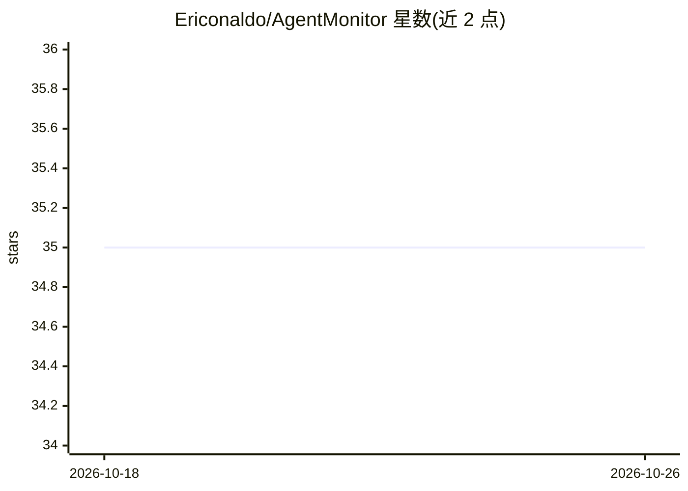

# Ericonaldo/AgentMonitor

⭐ 35 · TypeScript · 推送 2026-05-22 · [GitHub](https://github.com/Ericonaldo/AgentMonitor) · [官网](https://ericonaldo.github.io/AgentMonitor/) · 个人维护 · 中文 README

**浏览器中运行与监控多个 Claude Code/Codex agent 的 Web 仪表盘**

基于 Node.js/React/TypeScript 的 Web 仪表盘，用于创建、监控和管理本机安装的 Claude Code CLI 与 Codex CLI agent。提供可克隆的 agent 配置模板（CLAUDE.md/AGENTS.md 指令模板）、顺序/并行任务管道、git worktree 隔离、WebSocket 实时输出流、PTY 网页终端、会话恢复、外部进程自动发现、成本与 token 追踪，以及 Email/WhatsApp/Slack/飞书通知；通过中继服务器实现远程访问。从源码安装，需 Node.js ≥18 与对应 CLI。

## 筛选速览

| 维度 | 判定 | 备注 |
|---|---|---|
| AI 角色 | `ai-ecosystem` | LLM/agent 周边工具 |
| 许可风险 | `none` | — |
| 部署形态 | `library` | 以包/库形式分发 |
| 模型依赖 | locked-api |  |
| 硬件要求 | — | 无带数字的原话,不猜 |
| 安装摩擦 | `low` | 无编译、无系统依赖或容器化 |
| 成熟度 | — | 结构信号不足 |

## 能力要点

- 统一界面创建/监控 Claude Code 与 Codex agent，支持配置克隆与指令模板
- 任务管道、git worktree 隔离、PTY 网页终端与会话恢复
- WebSocket 实时流输出与外部启动 agent 的自动发现
- Email/WhatsApp/Slack/飞书四通道通知，中继服务器远程访问

## 适用场景

- 在同一界面并行运行和监督多个编码 agent
- 用任务管道编排多 agent 的顺序/并行工作流
- 手机或异地设备通过中继远程管理 agent 并接收通知

## 场景标签

`多智能体` `编码 Agent` · 领域:Agent 开发

## 证据(README 行号)

> L12: A web dashboard to run, monitor, and manage **Claude Code** and **Codex** agents in one place. Create agents with a
> L28: - **Unified dashboard** — Create, monitor, and manage Claude Code and Codex agents from a single interface

## 星数曲线

2026-10-18 35 → 2026-10-26 35（+0）

---
*卡片 v1 · prompt 1.4 · 生成 2026-10-25 · 置信度 high · 依据 README sha `b1b29d2a6173` · [字段定义](../../DATASET.md)*
