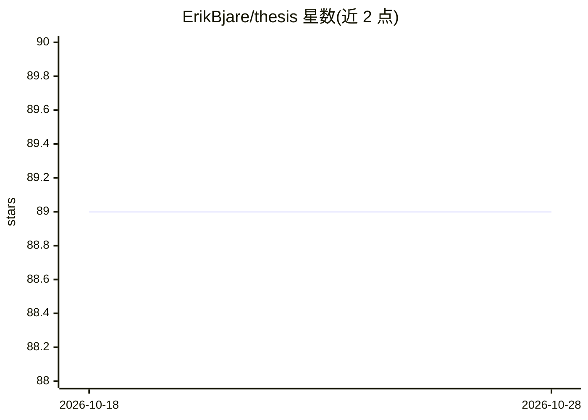

# ErikBjare/thesis

⭐ 89 · Python · 推送 2026-09-16 · [GitHub](https://github.com/ErikBjare/thesis) · [官网](https://erik.bjareholt.com/thesis/) · 个人维护

**硕士论文代码：用 EEG 与自动时间追踪区分用户电脑活动**

MSc 论文配套研究代码库：研究用脑电（EEG）区分用户在设备上从事的活动。复现代码理解与文本理解任务的脑活动差异研究，采用基于黎曼几何的机器学习分类器；引入 ActivityWatch 自动记录设备活动，将 EEG 数据与自然活动标注（如写代码 vs 写文章、工作 vs 媒体消费）对齐训练分类器。支持 Muse S、Neurosity、OpenBCI Cyton 等采集设备，提供 eegwatch 数据采集与 eegclassify 分类流程，依赖 Python 3.7+ 与 poetry。

## 筛选速览

| 维度 | 判定 | 备注 |
|---|---|---|
| AI 角色 | `ai-native` | 本体是模型或模型工具 |
| 许可风险 | `none` | — |
| 部署形态 | `library` | 以包/库形式分发 |
| 模型依赖 | — | README 未给出锁定关系 |
| 硬件要求 | — | 无带数字的原话,不猜 |
| 安装摩擦 | `low` | 无编译、无系统依赖或容器化 |
| 成熟度 | — | 结构信号不足 |

## 能力要点

- 基于黎曼几何的机器学习分类器训练与评估
- 用 ActivityWatch 自动标注 EEG 数据中的设备活动
- 支持 Muse S、Neurosity Notion/Crown、OpenBCI Cyton 等设备
- 提供训练/信号质量/活动分类等 CI 构建的 notebook

## 适用场景

- 复现代码理解与文本理解脑活动分类研究
- 采集消费级 EEG 设备数据并训练活动分类器
- 研究生如何用自动时间追踪给 EEG 数据打标签

## 场景标签

`科研工具` · 领域:学习与行业

## 证据(README 行号)

> L14: > We investigate the ability of EEG to distinguish between different activities users engage in on their devices, b
> L16: > Furthermore, we extend the scope of previous work by introducing the automated time tracking application Activity

## 星数曲线

2026-10-18 89 → 2026-10-28 89（+0）

---
*卡片 v1 · prompt 1.4 · 生成 2026-10-23 · 置信度 mid · 依据 README sha `da5938710bb2` · [字段定义](../../DATASET.md)*
