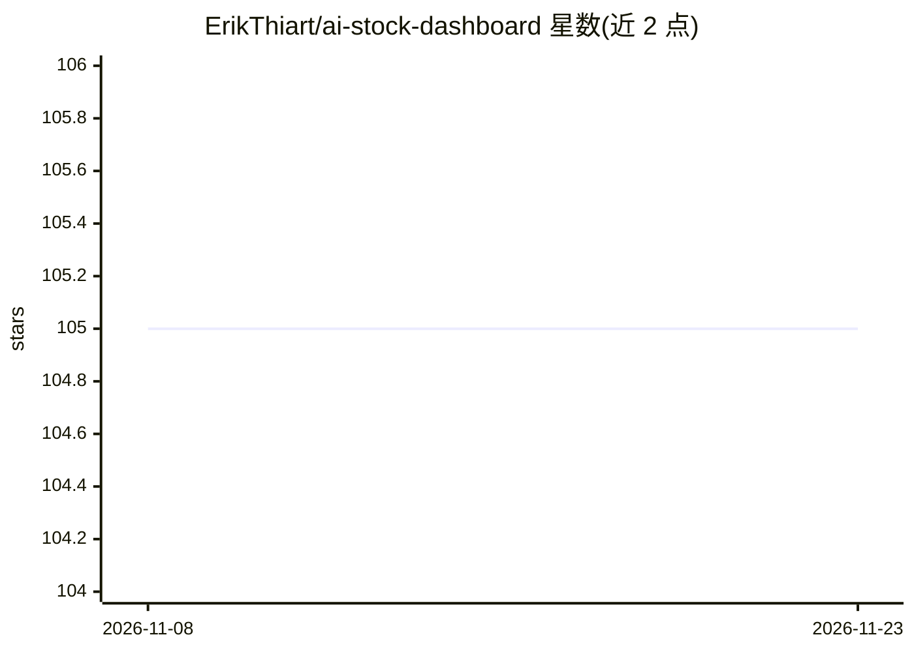

# ErikThiart/ai-stock-dashboard

⭐ 105 · Python · NOASSERTION · 推送 2026-11-08 · [GitHub](https://github.com/ErikThiart/ai-stock-dashboard) · [官网](https://analyze-stocks.streamlit.app/) · 个人维护

**股票技术分析与随机森林预测的 Streamlit 仪表盘**

基于 Streamlit 的股票市场仪表盘：输入任意股票代码后展示 K 线图、20+ 技术指标（RSI、MACD、布林带等）、风险指标（夏普比率、最大回撤）与基于技术指标的自然语言市场分析；AI 部分为随机森林回归模型预测，使用 30+ 技术特征，每次加载股票时重训。数据来自 Yahoo Finance（yfinance，可能延迟）。README 明确列出局限：随机划分训练/测试集导致时间序列信息泄漏、无朴素基线对比、无回测，并声明仅供教育用途。

## 筛选速览

| 维度 | 判定 | 备注 |
|---|---|---|
| AI 角色 | `ai-native` | 本体是模型或模型工具 |
| 许可风险 | `none` | NOASSERTION |
| 部署形态 | `library` | 以包/库形式分发 |
| 模型依赖 | — | README 未给出锁定关系 |
| 硬件要求 | — | 无带数字的原话,不猜 |
| 安装摩擦 | `low` | 无编译、无系统依赖或容器化 |
| 成熟度 | `idea` | |

## 能力要点

- 随机森林回归预测，30+ 技术特征，含特征重要性分析
- 20+ 技术指标与多面板 K 线图（Plotly）
- 风险指标：夏普比率、波动率、最大回撤
- 基于技术指标的自然语言市场分析

## 适用场景

- 快速查看某只股票的技术指标与风险指标
- 作为机器学习在金融中应用的学习示例
- 多时间框架（1M–5Y）的行情分析

## 场景标签

`金融量化` · 领域:学习与行业

## 证据(README 行号)

> L17: - **Machine Learning Price Prediction** - Random Forest model with 30+ technical features
> L18: - **AI Market Analysis** - Natural language insights based on technical indicators

## 星数曲线

2026-11-08 105 → 2026-11-23 105（+0）

---
*卡片 v1 · prompt 1.4 · 生成 2026-11-17 · 置信度 high · 依据 README sha `f5cdf19f8da4` · [字段定义](../../DATASET.md)*
