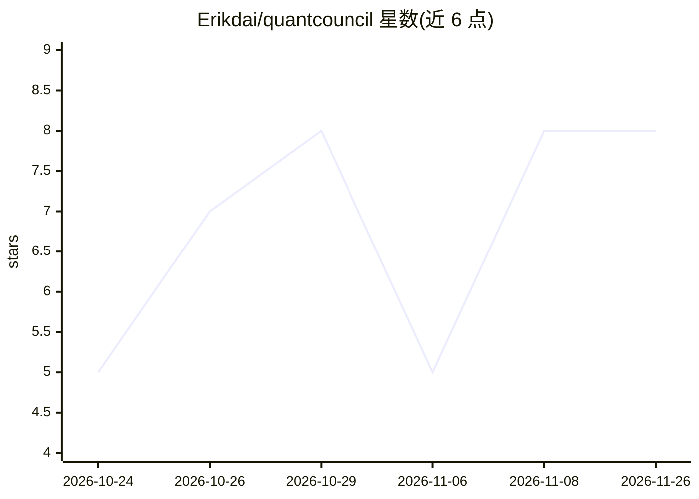

# Erikdai/quantcouncil

⭐ 8 · Python · Apache-2.0 · 推送 2026-10-26 · [GitHub](https://github.com/Erikdai/quantcouncil) · 个人维护 · 中文 README

**面向 A股与美股研究的多 Agent 分析与模拟交易平台**

基于 TradingAgents 多 Agent 框架扩展的研究与模拟交易（paper-trading）平台：分析师 Agent 并行研究个股，多空研究员辩论，交易员与风控委员会推演，由风控引擎以确定性代码执行规则（A股手数、T+1、涨跌停/ST、仓位与回撤限制）。平台不代下单，用户在券商成交后录入实际价格数量并记入哈希链账本。技术栈包括 LangGraph、MCP（14 个市场数据工具）、RAG 检索（pgvector + jieba）、Langfuse 追踪，提供 Docker Compose 部署与 Windows 桌面版。

## 筛选速览

| 维度 | 判定 | 备注 |
|---|---|---|
| AI 角色 | `ai-native` | 本体是模型或模型工具 |
| 许可风险 | `permissive` | Apache-2.0 |
| 部署形态 | `desktop` | 安装包/桌面程序 |
| 模型依赖 | — | README 未给出锁定关系 |
| 硬件要求 | — | 无带数字的原话,不猜 |
| 安装摩擦 | `low` | 无编译、无系统依赖或容器化 |
| 成熟度 | — | 结构信号不足 |

## 能力要点

- 多 Agent 研究流水线：分析师并行研究、多空辩论、风控委员会推演
- 风控规则由代码强制执行，非提示词约束；平台不代下单
- MCP server 提供 14 个市场数据工具，可被任意 MCP 客户端调用
- 研究 RAG：公告与券商研报混合检索（pgvector + jieba，RRF，重排序）并带引用

## 适用场景

- 模拟盘研究 A股/美股，记录真实成交与持仓
- 在 Claude Desktop 或 Cursor 中接入市场数据 MCP 工具
- 导出每日研究报告为 PDF 或 Word
- 本地运行桌面版做单用户分析，无需 Docker

## 场景标签

`多智能体` `RAG` `金融量化` · 领域:Agent 开发

## 证据(README 行号)

> L19: QuantCouncil turns the TradingAgents multi-agent framework into a full research platform for China A-shares and US 
> L24: - **Human in the loop**: every run pauses with LangGraph `interrupt` before an order; runs are checkpointed and res
> L38: |Agents|LangGraph 1.x (subgraphs, `interrupt`, Postgres or SQLite checkpointer and store), TradingAgents, DeepSeek 

## 星数曲线

2026-10-24 5 → 2026-11-26 8（+3）

---
*卡片 v1 · prompt 1.4 · 生成 2026-11-20 · 置信度 high · 依据 README sha `b9897b0705fd` · [字段定义](../../DATASET.md)*
