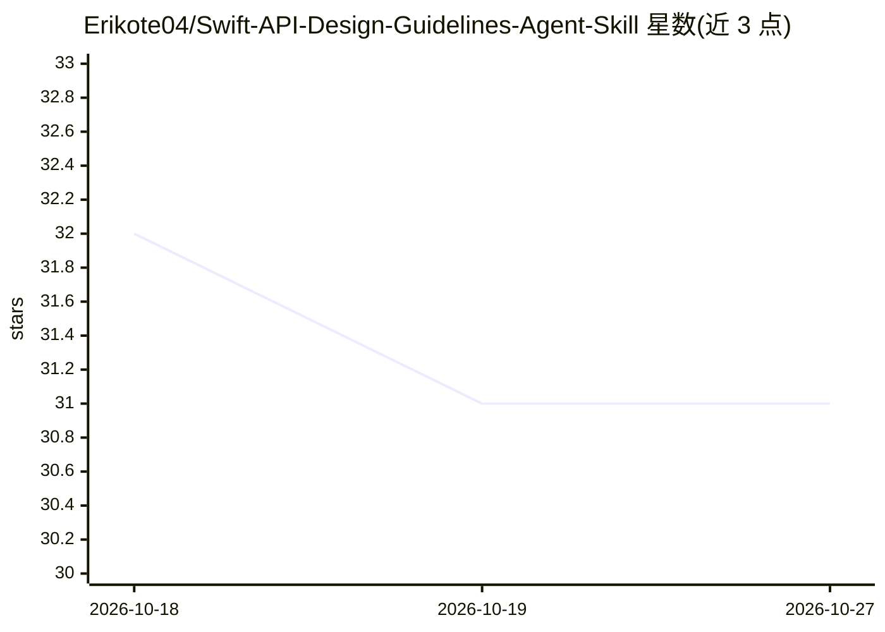

# Erikote04/Swift-API-Design-Guidelines-Agent-Skill

⭐ 31 · MIT · 推送 2026-02-18 · [GitHub](https://github.com/Erikote04/Swift-API-Design-Guidelines-Agent-Skill) · 个人维护

**面向 AI 编码工具的 Swift API 设计规范技能包**

将 Swift API Design Guidelines 提炼为 Agent Skills 开放格式技能：以 SKILL.md 工作流加 references 主题模块，指导 AI 编码工具在命名、argument labels、术语、文档注释与约定上做 API 设计与评审。适用于设计或评审 Swift API/SDK 的团队、重构 API 的开发者。提供三种安装途径：npx skills 安装、Claude Code 插件机制、手动 clone/symlink；目录结构为 SKILL.md 与 references 文件夹，MIT 许可。

## 筛选速览

| 维度 | 判定 | 备注 |
|---|---|---|
| AI 角色 | `ai-knowledge` | 知识聚合/清单类 |
| 许可风险 | `permissive` | MIT |
| 部署形态 | `library` | 以包/库形式分发 |
| 模型依赖 | — | README 未给出锁定关系 |
| 硬件要求 | — | 无带数字的原话,不猜 |
| 安装摩擦 | `low` | 无编译、无系统依赖或容器化 |
| 成熟度 | — | 结构信号不足 |

## 能力要点

- 将 Swift API Design Guidelines 蒸馏为 SKILL.md 工作流与专题参考模块
- 覆盖命名、argument labels、术语、文档注释与 API 评审检查
- 支持 skills.sh、Claude Code 插件与手动安装三种方式

## 适用场景

- 让 AI 编码工具在写 Swift 代码时遵循 API 命名与参数标签规范
- 团队代码评审中检查 API 清晰度与一致性
- 为仓库统一配置可自动分发的 API 设计规范技能

## 场景标签

 · 领域:软件开发/API 设计规范

## 证据(README 行号)

> L3: Expert guidance for any AI coding tool that supports the Agent Skills open format - focused on Swift API naming, arg
> L5: This repository distills the Swift API Design Guidelines into actionable, concise references for agents and code rev

## 星数曲线

2026-10-18 32 → 2026-10-27 31（-1）

---
*卡片 v1 · prompt 1.4 · 生成 2026-10-26 · 置信度 high · 依据 README sha `b215b08922e4` · [字段定义](../../DATASET.md)*
