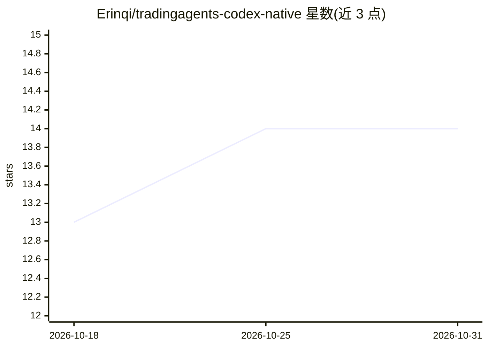

# Erinqi/tradingagents-codex-native

⭐ 14 · Python · Apache-2.0 · 推送 2026-07-12 · [GitHub](https://github.com/Erinqi/tradingagents-codex-native) · 个人维护 · 中文 README

**在 Codex 内运行的多角色金融研究插件，无需外部模型 API 密钥**

TradingAgents 风格的 Codex 原生插件：由当前 Codex 任务模型承担市场、情绪、新闻、基本面、牛熊辩论、交易规划、风险审查与投资组合经理等最多 13 个角色阶段，产出五档评级报告；不调用 OpenAI/Anthropic/Google 等外部模型接口，内置 Nasdaq、Yahoo Finance、CoinGecko 无密钥行情回退，支持美股、港股、A 股、加密资产等标的。支持历史截点分析、断点续跑与决策记忆；声明不执行交易、不构成投资建议。辅助脚本仅用 Python 标准库，作为个人 Codex 插件安装。

## 筛选速览

| 维度 | 判定 | 备注 |
|---|---|---|
| AI 角色 | `ai-native` | 本体是模型或模型工具 |
| 许可风险 | `permissive` | Apache-2.0 |
| 部署形态 | `None` |  |
| 模型依赖 | — | README 未给出锁定关系 |
| 硬件要求 | — | 无带数字的原话,不猜 |
| 安装摩擦 | `low` | 无编译、无系统依赖或容器化 |
| 成熟度 | — | 结构信号不足 |

## 能力要点

- 最多 13 个角色阶段的完整多角色研究流程，输出五档评级
- 无需外部模型密钥，推理由当前 Codex 任务提供
- 内置 Nasdaq/Yahoo Finance/CoinGecko 无密钥行情数据回退
- 历史截点分析、断点续跑与持久决策记忆

## 适用场景

- 在 Codex 中对股票或加密资产做多角色研究报告
- 限定截至日期复盘历史时点的分析
- 生成带证据来源清单与风险审查的投资研究文档

## 场景标签

`多智能体` `金融量化` · 领域:Agent 开发

## 证据(README 行号)

> L9: 它让当前 Codex 模型承担市场、情绪、新闻、基本面、牛熊研究、交易计划、风险审查和投资组合经理等角色，不调用外部大模型供应商，也不要求用户提供 OpenAI、Anthropic、Google 或其他模型 API 密钥。
> L19: - **Codex 原生推理**：所有角色直接使用当前 Codex 任务中的模型和工具。
> L174: 上游 TradingAgents 通过 LangGraph 调用用户选择的外部模型供应商。本项目将角色编排改写为 Codex Skill：当前 Codex 任务本身提供推理能力，因此不再需要额外调用模型 API。

## 星数曲线

2026-10-18 13 → 2026-10-31 14（+1）

---
*卡片 v1 · prompt 1.4 · 生成 2026-10-31 · 置信度 high · 依据 README sha `24bb5f1d62cd` · [字段定义](../../DATASET.md)*
