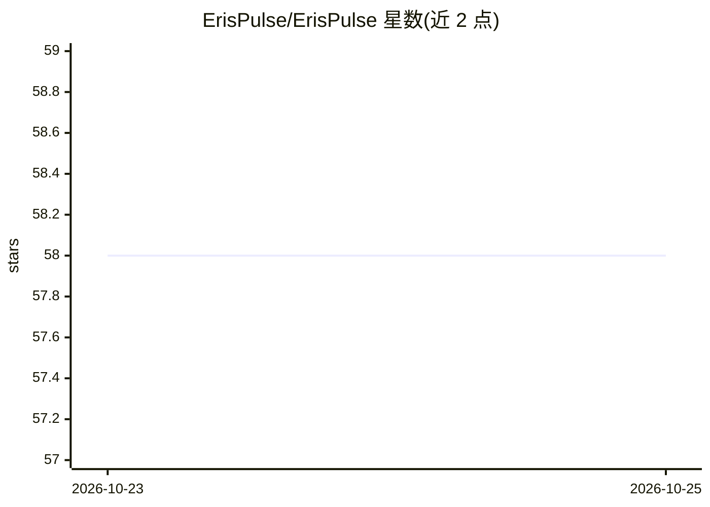

# ErisPulse/ErisPulse

⭐ 58 · Python · MIT · 推送 2026-10-24 · [GitHub](https://github.com/ErisPulse/ErisPulse) · [官网](https://www.erisdev.com) · 组织维护 · 中文 README

**事件驱动的多平台聊天机器人框架，一套代码接入 15+ 平台**

基于 Python asyncio 与 OneBot12 标准事件的模块化机器人框架：适配器层将 QQ/Telegram/Kook/云湖/微信公众号/Matrix/邮件/Webhook 等 15+ 平台的原生协议转换为统一事件，业务代码只写一次。提供热重载、模块市场、Dashboard 可视化管理面板、链式发送 DSL（一行完成 @/回复/重试/超时）、多轮对话管理、平台/Bot/会话三维权限控制与事件覆盖机制。安装途径含 pip、Docker、一键脚本、1Panel 应用商店，附 epsdk 脚手架 CLI。AI 能力（自然语言生成模块的 AI Builder）作为生态组件提供。

## 筛选速览

| 维度 | 判定 | 备注 |
|---|---|---|
| AI 角色 | `ai-enhanced` | 去掉 AI 部分产品仍成立 |
| 许可风险 | `permissive` | MIT |
| 部署形态 | `self-host` | docker 或自建部署 |
| 模型依赖 | — | README 未给出锁定关系 |
| 硬件要求 | — | 无带数字的原话,不猜 |
| 安装摩擦 | `low` | 无编译、无系统依赖或容器化 |
| 成熟度 | — | 结构信号不足 |

## 能力要点

- 适配器层统一 15+ 平台为 OneBot12 标准事件，业务代码不改
- 热重载与热插拔插件，插件作用域可按平台/Bot/会话控制
- 链式 SendDSL 一行完成 @/回复/重试/超时/批量发送
- Dashboard 可视化管理 + Docker 镜像（amd64/arm64）+ 模块市场

## 适用场景

- 一套机器人代码同时部署到 QQ、Telegram、Kook 等多个平台
- 通过 Dashboard 在线管理插件、日志与配置并热更新框架
- 用 epsdk 脚手架快速初始化并开发机器人项目

## 场景标签

 · 领域:聊天机器人/自动化框架

## 证据(README 行号)

> L7: **Write once, deploy to QQ / Telegram / Kook / Yunhu / WeChat Official Accounts / OneBot12 / ... multiple platforms.
> L51: AI Assistance

## 星数曲线

2026-10-23 58 → 2026-10-25 58（+0）

---
*卡片 v1 · prompt 1.4 · 生成 2026-10-24 · 置信度 high · 依据 README sha `2fbf34c33bc4` · [字段定义](../../DATASET.md)*
