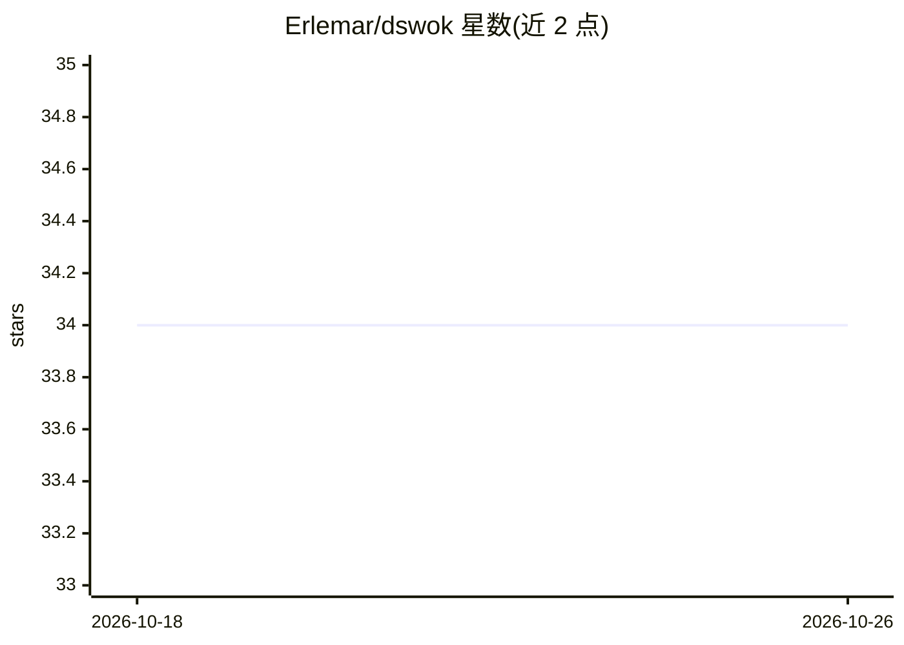

# Erlemar/dswok

⭐ 34 · JavaScript · CC-BY-4.0 · 推送 2026-07-31 · [GitHub](https://github.com/Erlemar/dswok) · [官网](https://dswok.com/Index) · 个人维护

**机器学习与数据科学互链笔记知识库（Obsidian 仓库）**

以 Obsidian vault 形式组织的机器学习与数据科学知识库：互链笔记覆盖经典算法、深度学习、NLP、指标与损失函数、ML 系统设计、面试准备及生产案例。面向从业者作为工作或面试准备时的参考。使用方式包括 dswok.com 在线阅读、git clone 后在 Obsidian 中打开以获得图谱视图与反向链接，或在 GitHub 上直接浏览 Markdown 文件。内容以 CC BY 4.0 许可发布。

## 筛选速览

| 维度 | 判定 | 备注 |
|---|---|---|
| AI 角色 | `ai-knowledge` | 知识聚合/清单类 |
| 许可风险 | `viral` | CC-BY-4.0 |
| 部署形态 | `None` |  |
| 模型依赖 | — | README 未给出锁定关系 |
| 硬件要求 | — | 无带数字的原话,不猜 |
| 安装摩擦 | `low` | 无编译、无系统依赖或容器化 |
| 成熟度 | — | 结构信号不足 |

## 能力要点

- Obsidian 互链笔记结构，提供图谱视图与反向链接
- 覆盖算法、架构、指标、系统设计与面试准备
- 支持在线阅读、本地 Obsidian 与 GitHub 浏览三种方式
- 内容以 CC BY 4.0 许可发布

## 适用场景

- 工作中快速查阅 ML 算法与指标定义
- 面试前复习机器学习基础与系统设计
- 在 Obsidian 中以图谱方式浏览关联概念

## 场景标签

`知识库管理` · 领域:知识与检索

## 证据(README 行号)

> L3: An open-source ML knowledge base: algorithms, architectures, metrics, system design, and interview preparation.
> L9: DSWoK is an Obsidian vault of interconnected notes on machine learning and data science. It's designed as a referenc

## 星数曲线

2026-10-18 34 → 2026-10-26 34（+0）

---
*卡片 v1 · prompt 1.4 · 生成 2026-10-25 · 置信度 high · 依据 README sha `07ecd7e8327a` · [字段定义](../../DATASET.md)*
