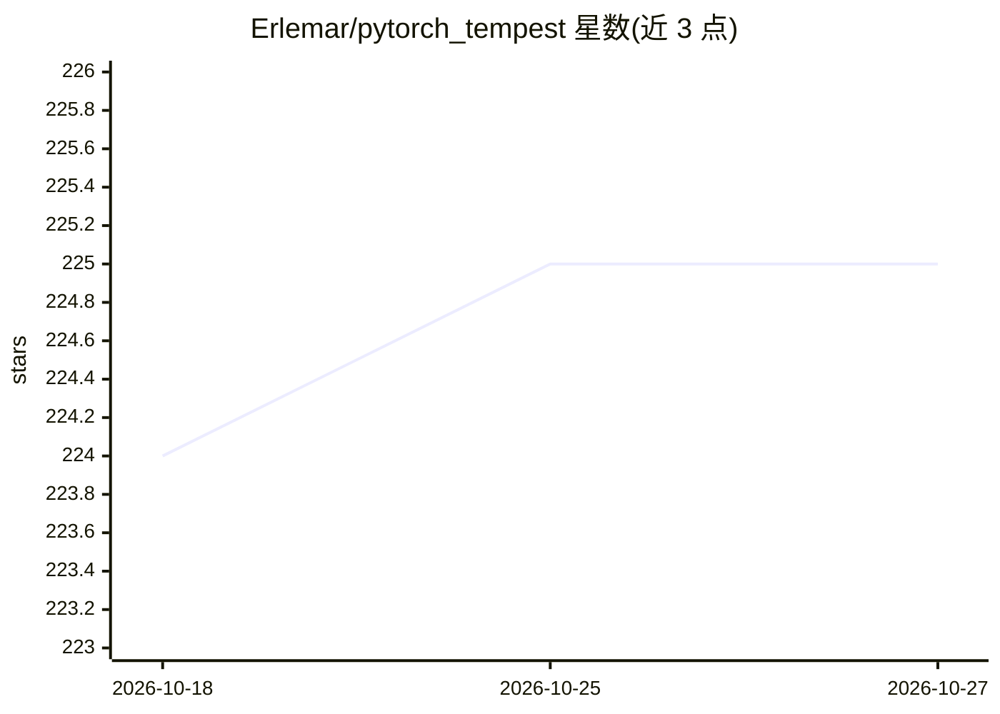

# Erlemar/pytorch_tempest

⭐ 225 · Python · MIT · 推送 2026-05-12 · [GitHub](https://github.com/Erlemar/pytorch_tempest) · [官网](https://pytorch-tempest.readthedocs.io/en/latest/) · 个人维护

**个人 PyTorch-Lightning+Hydra 神经网络训练流水线模板**

作者个人维护的深度学习训练流水线仓库：基于 pytorch-lightning 训练框架与 hydra 配置管理，所有参数与模块通过配置文件定义，可预先准备不同优化器/调度器的配置以便切换。当前提供图像分类与命名实体识别两类任务的模板，支持 MNIST/imagenette 数据集，可在 MPS（M1）上运行。安装推荐使用 uv（uv sync）或 pip 安装 requirements.txt，通过 train.py 以命令行覆盖配置启动训练。

## 筛选速览

| 维度 | 判定 | 备注 |
|---|---|---|
| AI 角色 | `ai-ecosystem` | LLM/agent 周边工具 |
| 许可风险 | `permissive` | MIT |
| 部署形态 | `library` | 以包/库形式分发 |
| 模型依赖 | — | README 未给出锁定关系 |
| 硬件要求 | — | 无带数字的原话,不猜 |
| 安装摩擦 | `low` | 无编译、无系统依赖或容器化 |
| 成熟度 | — | 结构信号不足 |

## 能力要点

- hydra 配置驱动：所有参数与模块在配置中定义
- 支持切换不同优化器/调度器（含 adan、schedule free）
- 图像分类与命名实体识别任务模板
- 提供 MPS（M1）运行示例

## 适用场景

- 以配置模板快速启动图像分类或 NER 训练
- 在不同优化器与调度器之间切换实验
- 在 Apple Silicon (MPS) 上跑 PyTorch 训练

## 场景标签

`模型训练` · 领域:训练与推理

## 证据(README 行号)

> L9: * hydra
> L10: * pytorch-lightning
> L16: * have templates for different deep learning tasks. Currently, image classification and named entity recognition ar

## 星数曲线

2026-10-18 224 → 2026-10-27 225（+1）

---
*卡片 v1 · prompt 1.4 · 生成 2026-10-22 · 置信度 high · 依据 README sha `9c67688f86e8` · [字段定义](../../DATASET.md)*
