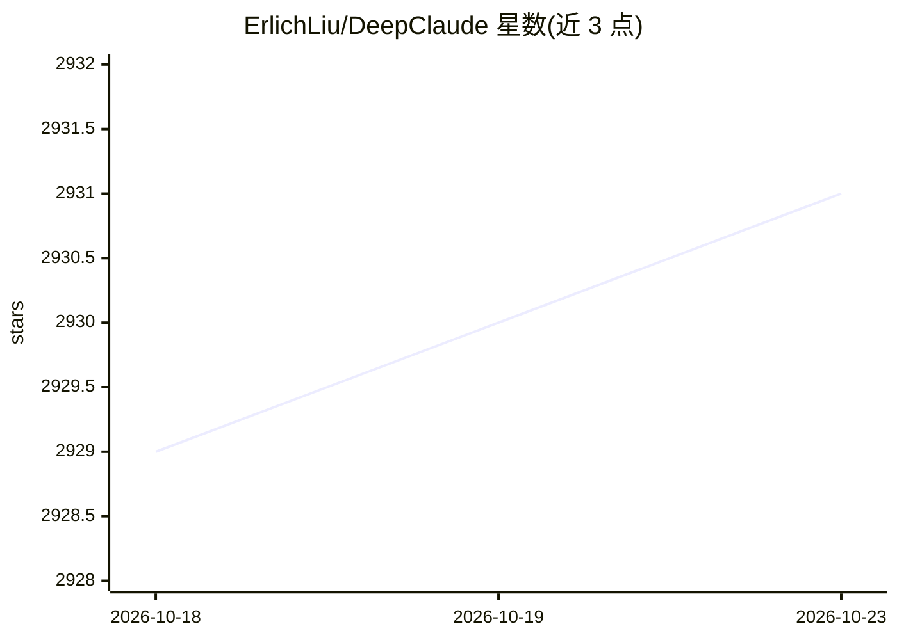

# ErlichLiu/DeepClaude

⭐ 2,931 · Python · MIT · 推送 2026-02-23 · [GitHub](https://github.com/ErlichLiu/DeepClaude) · [官网](https://erlich.fun/deepclaude-pricing) · 个人维护 · 中文 README

**组合推理与生成模型、提供 OpenAI 兼容 API 的转发服务**

基于 FastAPI 的模型组合服务：将 DeepSeek R1 作为推理模型，与 Claude Sonnet 或 Gemini 组合，形成 deepclaude、deepgeminiflash、deepgeminipro 三种组合模型，以 OpenAI 兼容格式对外提供 API，支持流式与非流式请求。支持图形化配置界面，可配置 DeepSeek 官方及 PPIO、Siliconflow 等第三方供应商，生成侧支持 Claude 官方 API 及 OpenRouter 等中转。通过 Docker 部署，供希望在日常聊天客户端中使用组合模型的用户自建服务。

## 筛选速览

| 维度 | 判定 | 备注 |
|---|---|---|
| AI 角色 | `ai-ecosystem` | LLM/agent 周边工具 |
| 许可风险 | `permissive` | MIT |
| 部署形态 | `self-host` | docker 或自建部署 |
| 模型依赖 | locked-api |  |
| 硬件要求 | — | 无带数字的原话,不猜 |
| 安装摩擦 | `low` | 无编译、无系统依赖或容器化 |
| 成熟度 | — | 结构信号不足 |

## 能力要点

- DeepSeek R1 推理 + Claude/Gemini 生成的组合模型方案
- 提供 OpenAI 兼容格式的 API 输入输出与 models 接口
- 1.0 版本提供图形化配置界面与配置导入导出
- Docker 镜像多平台支持，配置文件绑定本地卷防止丢失

## 适用场景

- 在 Cherry Studio、LobeChat 等客户端中使用 R1+Claude/Gemini 组合模型
- 自建服务器对外提供组合模型的 OpenAI 兼容 API 接口
- 通过 OneAPI 等统一分发接入组合模型

## 场景标签

`模型网关` · 领域:Agent 开发

## 证据(README 行号)

> L89: 项目**支持 OpenAI 兼容格式的输入输出**，支持 DeepSeek 官方 API 以及第三方托管的 API、生成部分也支持 Claude 官方 API 以及中转 API，并对 OpenAI 兼容格式的其他 Model 做了
> L92: 1.用户可以自行运行在自己的服务器，并对外提供开放 API 接口，接入 OneAPI 等实现统一分发。

## 星数曲线

2026-10-18 2,929 → 2026-10-23 2,931（+2）

---
*卡片 v1 · prompt 1.4 · 生成 2026-10-21 · 置信度 high · 依据 README sha `37fcade40959` · [字段定义](../../DATASET.md)*
