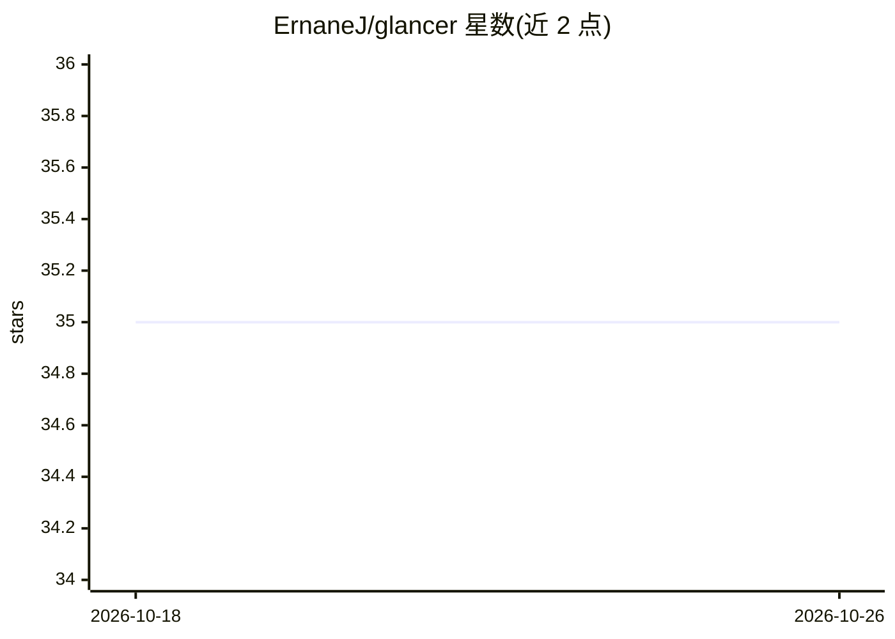

# ErnaneJ/glancer

⭐ 35 · Ruby · MIT · 推送 2026-06-05 · [GitHub](https://github.com/ErnaneJ/glancer) · [官网](https://rubygems.org/gems/glancer) · 个人维护

**Rails 引擎：让团队用自然语言查询数据库，无需写 SQL**

以 Rails engine 形式挂载到应用内的聊天界面：用户用自然语言提问，Glancer 检索相关 schema 上下文，由 LLM 生成 SQL SELECT 或 ActiveRecord 表达式，校验后在回滚事务中执行，返回结果及自然语言解释。通过 Markdown 文件注入领域知识，支持 Gemini/OpenAI/OpenRouter 三类 provider 按角色混配，嵌入向量存储在现有数据库内，无需外部向量库。要求 Ruby 3.3+、Rails 7.0+ 及 LLM API key。

## 筛选速览

| 维度 | 判定 | 备注 |
|---|---|---|
| AI 角色 | `ai-native` | 本体是模型或模型工具 |
| 许可风险 | `permissive` | MIT |
| 部署形态 | `None` |  |
| 模型依赖 | locked-api |  |
| 硬件要求 | — | 无带数字的原话,不猜 |
| 安装摩擦 | `low` | 无编译、无系统依赖或容器化 |
| 成熟度 | — | 结构信号不足 |

## 能力要点

- RAG 检索 schema/模型/领域上下文后生成 SQL 或 ActiveRecord 查询
- 安全机制：回滚事务、写语句黑名单、表校验、语句超时、执行审计
- 按角色混配 provider（代码生成/对话/嵌入/问题改写各自可配）
- 聊天界面含图表自动生成、CSV 导出、@表名补全、内联改写重跑

## 适用场景

- 团队非技术人员直接用自然语言查业务数据
- 产品经理和干系人自助取数，减少向工程师提临时查询需求
- 在 Rails 应用内提供带 schema 知识的数据库问答助手

## 场景标签

`数据分析` · 领域:效率与自动化

## 证据(README 行号)

> L24: Glancer is a **Ruby on Rails engine** that mounts a full chat interface inside your app and lets anyone on your tea
> L58: Glancer is built on top of **ruby_llm**, a provider-agnostic LLM client for Ruby. All LLM calls (query generation, 

## 星数曲线

2026-10-18 35 → 2026-10-26 35（+0）

---
*卡片 v1 · prompt 1.4 · 生成 2026-10-25 · 置信度 high · 依据 README sha `c37122858072` · [字段定义](../../DATASET.md)*
