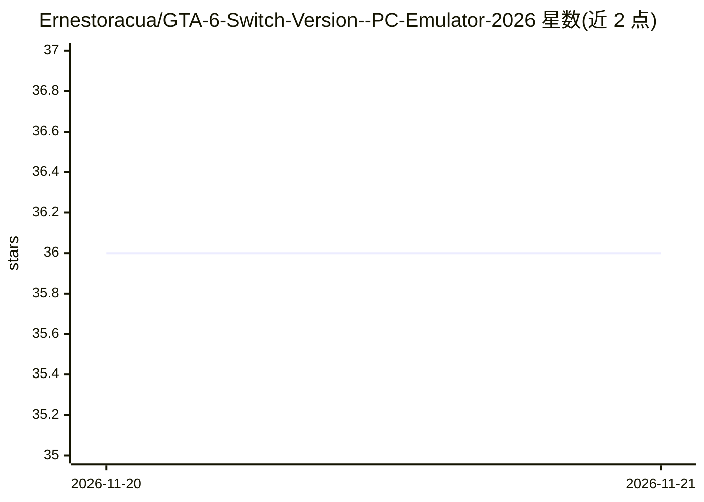

# Ernestoracua/GTA-6-Switch-Version--PC-Emulator-2026

⭐ 36 · Rust · Apache-2.0 · 推送 2026-11-19 · [GitHub](https://github.com/Ernestoracua/GTA-6-Switch-Version--PC-Emulator-2026) · 个人维护

**面向 Windows 玩家的 GTA VI PC 版安装准备与优化指南**

该项目为尚未发布 PC 版的 GTA VI 提供安装与配置准备资料：Windows 环境检查（系统版本、DirectX、驱动、存储）、图形与 FPS 优化建议、安装故障排查清单，以及一个不含游戏文件的 Windows 配套安装程序（.exe）。官方 PC 版发布日期与硬件要求均未确认，各设置条目标注将在官方信息公布后补充。仓库标签含 ai 相关词，但 README 正文未出现任何 AI 功能描述。

## 筛选速览

| 维度 | 判定 | 备注 |
|---|---|---|
| AI 角色 | `ai-knowledge` | 知识聚合/清单类 |
| 许可风险 | `permissive` | Apache-2.0 |
| 部署形态 | `desktop` | 安装包/桌面程序 |
| 模型依赖 | — | README 未给出锁定关系 |
| 硬件要求 | — | 无带数字的原话,不猜 |
| 安装摩擦 | `low` | 无编译、无系统依赖或容器化 |
| 成熟度 | — | 结构信号不足 |

## 能力要点

- Windows 兼容性检查：系统版本、DirectX、驱动、存储
- 通用 PC 图形设置与 FPS/帧时间优化指南
- 安装故障排查分类清单（依赖、权限、启动器等）
- 配套 .exe 安装程序声明不含 GTA VI 游戏文件

## 适用场景

- PC 版发布前提前准备 Windows 环境与驱动
- 排查游戏安装与显示初始化类错误
- 了解 PC 游戏通用图形优化选项

## 场景标签

 · 领域:游戏/工具指南

## 证据(README 行号)

> L3: ### GTA 6 PC Installation, Setup & Performance Guide
> L19: The installation resource focuses on:
> L234: The PC version has not received an official release date as of November 18, 2026.

## 星数曲线

2026-11-20 36 → 2026-11-21 36（+0）

---
*卡片 v1 · prompt 1.4 · 生成 2026-11-20 · 置信度 mid · 依据 README sha `6954d37a13d3` · [字段定义](../../DATASET.md)*
