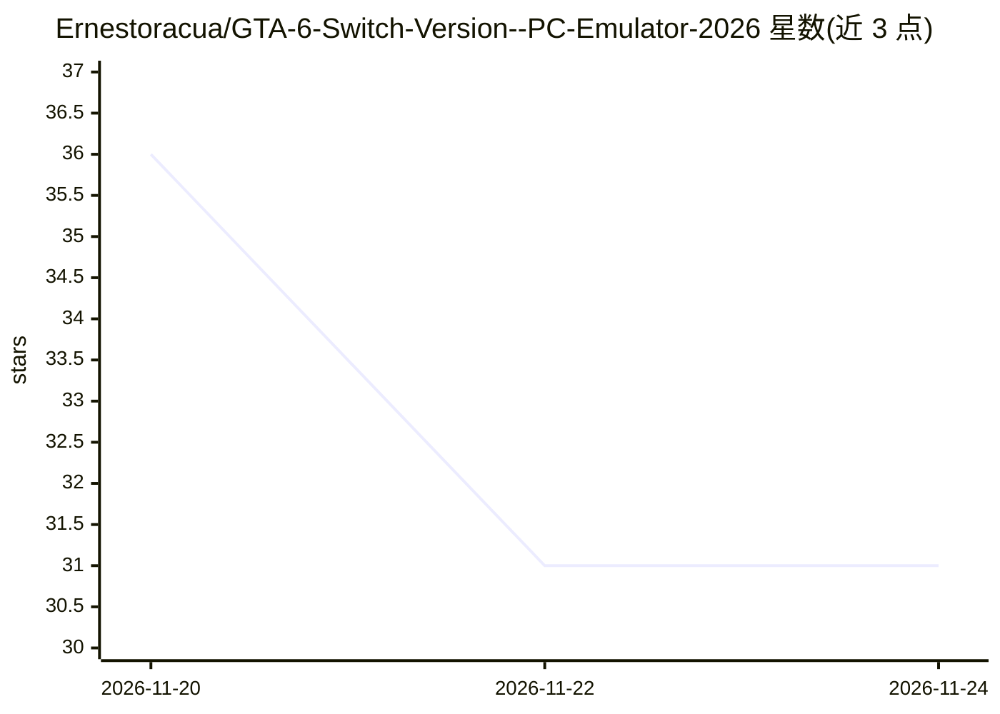

# Ernestoracua/GTA-6-Switch-Version--PC-Emulator-2026

⭐ — · [GitHub]() · 个人维护

**GTA VI PC 版安装准备与配置指南（Windows）**

面向 Windows 10/11 用户的 GTA VI PC 版安装与配置资源：覆盖 Windows 准备、显卡驱动更新、存储检查、Rockstar Games Launcher 准备、图形/帧率优化思路与安装故障排查。README 明确说明配套安装器不含也不安装 GTA VI 游戏文件，且官方 PC 版发布日期与系统要求均未公布，各硬件规格在表格中标注为 Not confirmed。主题标签含 ai/generative-ai，但 README 正文未出现任何 AI 相关功能或模型调用描述。

## 筛选速览

| 维度 | 判定 | 备注 |
|---|---|---|
| AI 角色 | `ai-enhanced` | 去掉 AI 部分产品仍成立 |
| 许可风险 | `permissive` | — |
| 部署形态 | `desktop` | 安装包/桌面程序 |
| 模型依赖 | — | README 未给出锁定关系 |
| 硬件要求 | — | 无带数字的原话,不猜 |
| 安装摩擦 | `low` | 无编译、无系统依赖或容器化 |
| 成熟度 | — | 结构信号不足 |

## 能力要点

- Windows 兼容性准备：版本检查、DirectX、驱动与存储核查
- 图形与 FPS 优化条目清单（分辨率/纹理/阴影/超分/帧生成等）
- 安装与性能故障排查分类（缺依赖、驱动、存储、启动器等）
- README 声明安装器不包含或安装 GTA VI 游戏文件

## 适用场景

- 在 GTA VI PC 版发布前提前准备 Windows 环境
- 排查 PC 游戏常见的安装错误与帧率问题
- 按厂商链接更新 NVIDIA/AMD/Intel 显卡驱动

## 场景标签

 · 领域:游戏/桌面工具

## 证据(README 行号)

> L17: This repository is dedicated to Windows users preparing for the future PC edition of GTA VI.
> L49: The companion installer does not contain or install GTA VI game files.
> L238: No. The project installer is intended for a separate Windows setup companion. GTA VI must be acquired through an a

## 星数曲线

2026-11-20 36 → 2026-11-24 31（-5）

---
*卡片 v1 · prompt 1.4 · 生成 2026-11-22 · 置信度 low · 依据 README sha `2fe487426686` · [字段定义](../../DATASET.md)*
