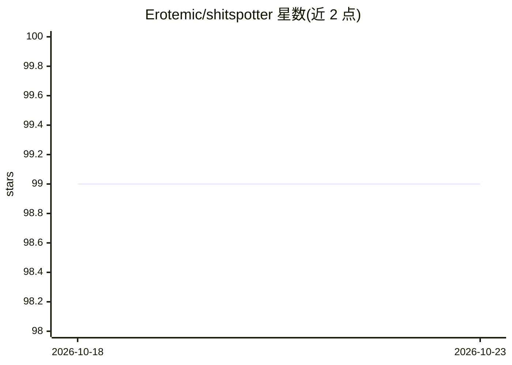

# Erotemic/shitspotter

⭐ 99 · Python · Apache-2.0 · 推送 2026-09-27 · [GitHub](https://github.com/Erotemic/shitspotter) · 个人维护

**狗粪便图片检测算法与开放数据集，面向手机应用找屎**

个人维护的计算机视觉项目：以 BAN 协议（拍摄前/拾取后/邻近区域三联图）持续采集户外狗粪便图片，每月新增约 1GB，标注与数据清单由 kwcoco 管理；提供用 PyTorch 训练检测网络（含 Grounding DINO、YOLO、Detectron 模型）的代码与用预训练模型对未见图片做检测的脚本。数据与模型经 IPFS、BitTorrent、Hugging Face 及集中式 Girder 服务器分发，数据集论文经同行评审发表于 WasteVision 2026（WACV）研讨会，配套手机应用尚在开发中。

## 筛选速览

| 维度 | 判定 | 备注 |
|---|---|---|
| AI 角色 | `ai-native` | 本体是模型或模型工具 |
| 许可风险 | `permissive` | Apache-2.0 |
| 部署形态 | `library` | 以包/库形式分发 |
| 模型依赖 | — | README 未给出锁定关系 |
| 硬件要求 | — | 无带数字的原话,不猜 |
| 安装摩擦 | `low` | 无编译、无系统依赖或容器化 |
| 成熟度 | — | 结构信号不足 |

## 能力要点

- BAN 三联图采集协议产生高/低相关负样本
- 数据与模型经 IPFS / BitTorrent / Hugging Face / Girder 多渠道分发
- PyTorch 训练代码与预训练模型推理脚本
- 数据集论文经同行评审（arXiv:2412.16473，WasteVision 2026）

## 适用场景

- 训练或研究户外小目标/粪便检测模型
- 获取带高相关负样本的开放图像数据集
- 为宠物或环卫场景构建检测应用的数据基础

## 场景标签

`目标检测` · 领域:感知与多模态

## 证据(README 行号)

> L16: This ``shitspotter`` repo is where I am building the "ShitSpotter" (or
> L25: This module will contain an algorithm for training a pytorch network to detect poop in images, and a script

## 星数曲线

2026-10-18 99 → 2026-10-23 99（+0）

---
*卡片 v1 · prompt 1.4 · 生成 2026-10-23 · 置信度 high · 依据 README sha `627252fb87a1` · [字段定义](../../DATASET.md)*
