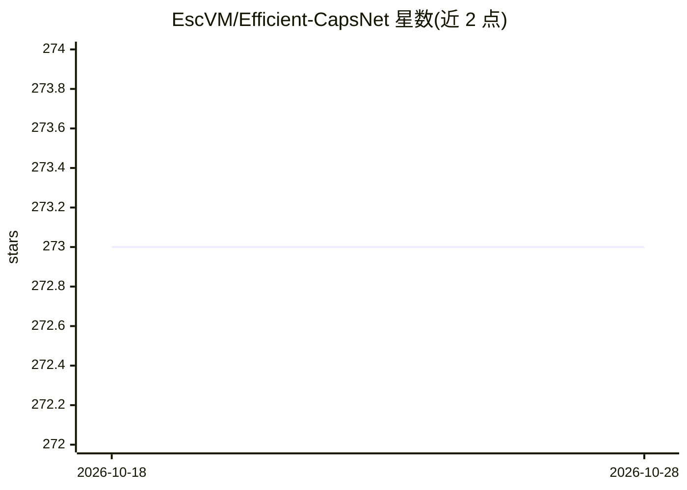

# EscVM/Efficient-CapsNet

⭐ 273 · Python · Apache-2.0 · 推送 2026-01-10 · [GitHub](https://github.com/EscVM/Efficient-CapsNet) · [官网](https://www.nature.com/articles/s41598-021-93977-0) · 组织维护

**Efficient-CapsNet 论文官方 TensorFlow 实现，供复现与扩展实验**

论文 "Efficient-CapsNet: Capsule Network with Self-Attention Routing" 的官方 TensorFlow 2.x 代码库，提供模型架构实现与多组 notebook：在 MNIST 等三个数据集上测试（附作者实验权重）、从头训练网络、复现原版 CapsNet（含来自原仓库的权重）、以及胶囊维度扰动可视化。README 明确说明 CapsNet 复现未能达到原论文报告分数（MNIST 上限 99.64%），原版权重取自 Sara Sabour 的仓库。面向机器学习研究者与实验者，训练建议使用 GPU 但非必需，部分 notebook 可在 Colab 运行。

## 筛选速览

| 维度 | 判定 | 备注 |
|---|---|---|
| AI 角色 | `ai-native` | 本体是模型或模型工具 |
| 许可风险 | `permissive` | Apache-2.0 |
| 部署形态 | `library` | 以包/库形式分发 |
| 模型依赖 | — | README 未给出锁定关系 |
| 硬件要求 | — | 无带数字的原话,不猜 |
| 安装摩擦 | `low` | 无编译、无系统依赖或容器化 |
| 成熟度 | — | 结构信号不足 |

## 能力要点

- Efficient-CapsNet 自注意力路由架构的 TensorFlow 2.x 实现
- 提供测试、训练、原版 CapsNet 复现与胶囊维度扰动四类 notebook
- 附带作者实验与原版仓库导出的权重
- 轻量网络，GPU 建议但非强制，可跑 Colab

## 适用场景

- 复现论文结果并基于架构做自己的胶囊网络实验
- 在 MNIST 等数据集上训练或测试 Efficient-CapsNet
- 可视化数字胶囊各维度学到的表示变化

## 场景标签

 · 领域:计算机视觉/深度学习研究

## 证据(README 行号)

> L9:  - open source the code (most of) developed during our "first-stage" research on capsules, summarized by the forthco
> L52: @article{mazzia2021efficient,

## 星数曲线

2026-10-18 273 → 2026-10-28 273（+0）

---
*卡片 v1 · prompt 1.4 · 生成 2026-10-22 · 置信度 mid · 依据 README sha `46fb99290ac4` · [字段定义](../../DATASET.md)*
